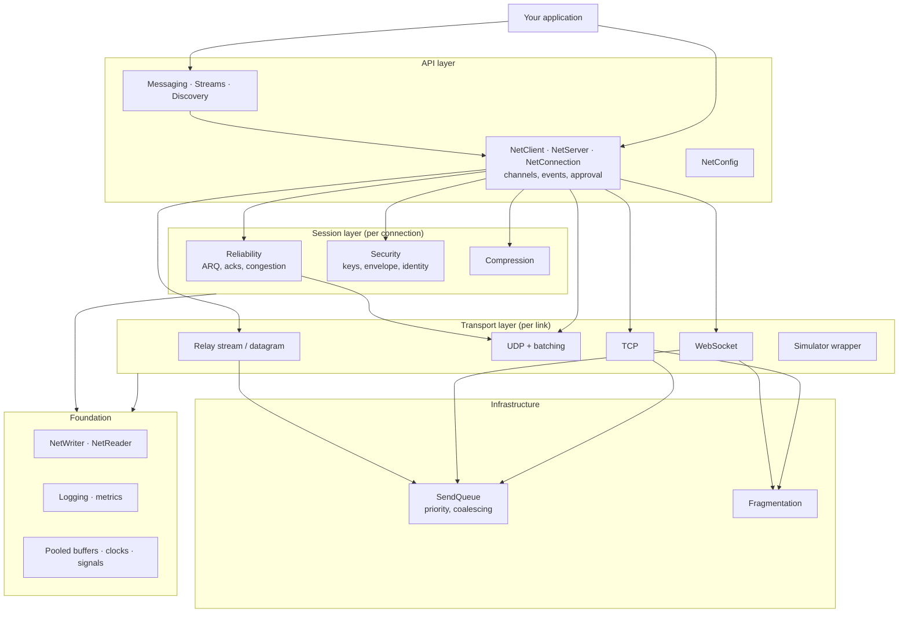
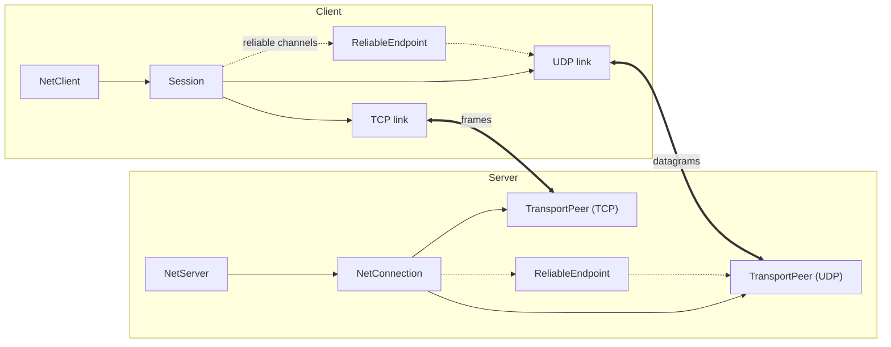

# Layers

| Layer | Folders | Responsibility | Key modules |
|---|---|---|---|
| API | `(root)`, `Peers`, `Messaging`, `Streams`, `Discovery` | the objects you use: connections, channels, events, typed messages | [NetClient](../Code/Peers/NetClient.md), [NetServer](../Code/Peers/NetServer.md), [NetConfig](../Code/Root/NetConfig.md), [NetMessages](../Code/Messaging/NetMessages.md), [NetStreams](../Code/Streams/NetStreams.md) |
| Session | `Pipeline/Reliability`, `Pipeline/Security`, `Pipeline/Compression` | what a connection does to its messages: reliable delivery, authentication, encryption, compression | [ReliableEndpoint](../Code/Pipeline/Reliability/ReliableEndpoint.md), [LinkSecurity](../Code/Pipeline/Security/LinkSecurity.md), [ConnectionCrypto](../Code/Pipeline/Security/ConnectionCrypto.md), [Compressor](../Code/Pipeline/Compression/Compressor.md) |
| Transports | `Transports`, `Transports/*`, `Relay` | moving packets over one link; slot contracts; the relay | [ITransport](../Code/Transports/ITransport.md), [UdpTransport](../Code/Transports/Udp/UdpTransport.md), [TcpTransport](../Code/Transports/Tcp/TcpTransport.md), [WebSocketTransportFactory](../Code/Transports/WebSockets/WebSocketTransportFactory.md), [RelayRoom](../Code/Relay/RelayRoom.md) |
| Infrastructure | `Sending`, `Pipeline/Fragmentation` | queues and fragmenting used by the stream transports | [SendQueue](../Code/Sending/SendQueue.md), [FragmentBuffer](../Code/Pipeline/Fragmentation/FragmentBuffer.md), [PacketFragmenter](../Code/Pipeline/Fragmentation/PacketFragmenter.md) |
| Foundation | `Serialization`, `Diagnostics`, `Internal` | primitives everything uses | [Pooled](../Code/Internal/Pooled.md), [NetTime](../Code/Internal/NetTime.md), [AsyncSignal](../Code/Internal/AsyncSignal.md), [NetWriter](../Code/Serialization/NetWriter.md), [INetLogger](../Code/Diagnostics/INetLogger.md) |

The generated [Dependency overview](../4%20Diagrams/Dependency%20overview.md) draws the real references between these folders and lists the few that go *against* the layering (e.g. the reliability engine building `PeerProtocol` messages, the relay reusing `ConnectionCrypto.FixedTimeEquals`).

## One connection, many links

A logical connection is one link per transport *slot* the channel table uses, grouped by a session token ([Handshake v4](../3%20Internals/Handshake%20v4.md)). Channels route to a slot; reliable UDP channels go through the connection's [ReliableEndpoint](../Code/Pipeline/Reliability/ReliableEndpoint.md). If UDP is unavailable, UDP channels ride the stream link ([When UDP is blocked](../2%20Guides/Connecting%20and%20approval.md#when-udp-is-blocked)).
