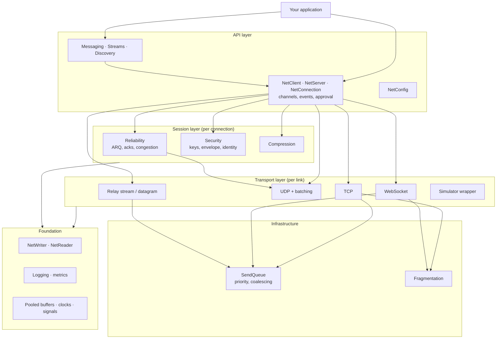
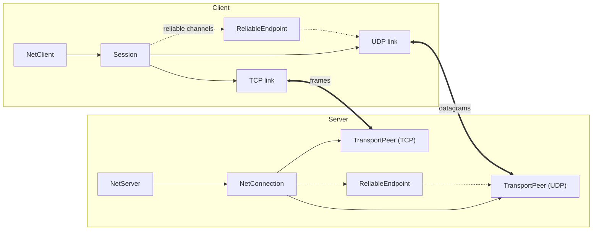

# Layers

| Layer | Folders | Responsibility | Key modules |
|---|---|---|---|
| API | `(root)`, `Peers`, `Messaging`, `Streams`, `Discovery` | the objects you use: connections, channels, events, typed messages | [[NetClient]], [[NetServer]], [[NetConfig]], [[NetMessages]], [[NetStreams]] |
| Session | `Pipeline/Reliability`, `Pipeline/Security`, `Pipeline/Compression` | what a connection does to its messages: reliable delivery, authentication, encryption, compression | [[ReliableEndpoint]], [[LinkSecurity]], [[ConnectionCrypto]], [[Compressor]] |
| Transports | `Transports`, `Transports/*`, `Relay` | moving packets over one link; slot contracts; the relay | [[ITransport]], [[UdpTransport]], [[TcpTransport]], [[WebSocketTransportFactory]], [[RelayRoom]] |
| Infrastructure | `Sending`, `Pipeline/Fragmentation` | queues and fragmenting used by the stream transports | [[SendQueue]], [[FragmentBuffer]], [[PacketFragmenter]] |
| Foundation | `Serialization`, `Diagnostics`, `Internal` | primitives everything uses | [[Pooled]], [[NetTime]], [[AsyncSignal]], [[NetWriter]], [[INetLogger]] |

The generated [[Dependency overview]] draws the real references between these folders and lists the few that go *against* the layering (e.g. the reliability engine building `PeerProtocol` messages, the relay reusing `ConnectionCrypto.FixedTimeEquals`).

## One connection, many links

A logical connection is one link per transport *slot* the channel table uses, grouped by a session token ([[Handshake v3]]). Channels route to a slot; reliable UDP channels go through the connection's [[ReliableEndpoint]]. If UDP is unavailable, UDP channels ride the stream link ([[Connecting and approval#When UDP is blocked]]).
