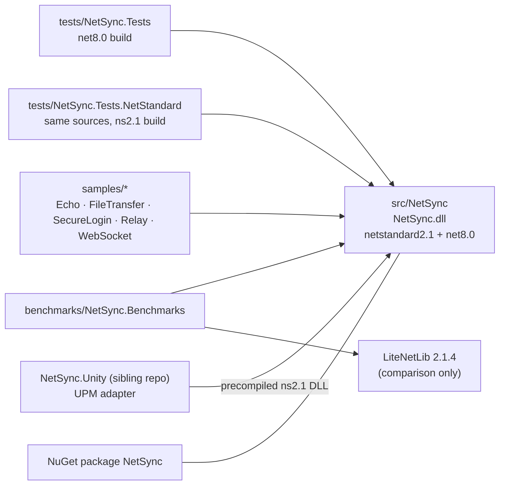

# Repository and projects



The core has **no** package references; the only external package anywhere is LiteNetLib in the benchmark project, for the side-by-side comparison ([[Benchmarks and performance]]).

## Layout

```
src/NetSync/                 the library (the only thing you ship)
  NetConfig.cs               configuration types
  Peers/                     NetClient, NetServer, NetConnection, handshake, events
  Transports/                slot contracts, framing, shared transport machinery
    Tcp/ Udp/ WebSockets/ Simulation/
  Relay/                     relay server and relay transports
  Pipeline/                  Reliability/ Security/ Fragmentation/ Compression/
  Sending/                   SendQueue
  Messaging/ Streams/ Discovery/ Serialization/ Diagnostics/ Internal/
tests/                       ~200 tests, run against both builds
benchmarks/                  throughput, compare, load, alloc, reliability
samples/                     console samples, each runnable in one process
tools/generate-vault.py      regenerates this vault's code notes and diagrams
docs/                        this vault
README.md, ARCHITECTURE.md
```

Per-folder module lists with diagrams: see [[Code index]] and `4 Diagrams/Modules`.

## Partial classes

[[NetClient]] and [[NetServer]] are split by concern into partial files — one code note each covers all parts:

| Module | Files |
|---|---|
| [[NetClient]] | `NetClient.cs` (API, send/receive, session end), `NetClient.Connect.cs` (links, handshake, fallback, join), `NetClient.Services.cs` (clock sync, MTU, reconnect) |
| [[NetServer]] | `NetServer.cs` (API, listeners, dispatch, send, stop), `NetServer.Handshake.cs` (hello, cookies, keys, join, approval, slots) |
