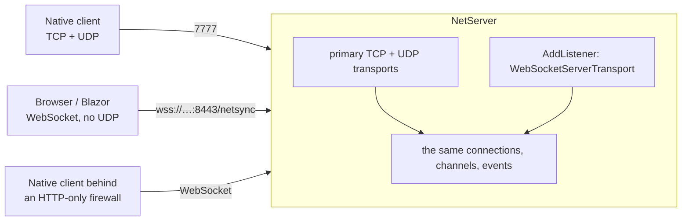

# Browsers and WebSocket

```csharp
var server = new NetServer(config);
var webSocket = new WebSocketTransportFactory { Path = "/netsync", ServerCertificate = cert }; // cert → wss://
webSocket.AllowedOrigins.Add("https://game.example.com");
server.AddListener(TransportType.Tcp, webSocket, 8443);   // browsers and HTTP-only networks
await server.StartAsync(7777);                           // native clients keep TCP+UDP here
```



- All listeners feed the same connections and events ([NetServer](../Code/Peers/NetServer.md) `AddListener`, [NetListener](../Code/Peers/NetListener.md)).
- A client without UDP sockets (browser) carries its UDP channels over the WebSocket automatically — the channel table stays identical everywhere ([When UDP is blocked](Connecting%20and%20approval.md#when-udp-is-blocked)).
- The server does its own HTTP upgrade on a `TcpListener` (TLS optional, Origin allow-list, bounded handshake time) — [WebSocketServerTransport](../Code/Transports/WebSockets/WebSocketServerTransport.md), [WebSocketHandshake](../Code/Transports/WebSockets/WebSocketHandshake.md). Packets travel as binary messages through [MessageLink](../Code/Transports/MessageLink.md).
- Client side (.NET, including Blazor WebAssembly): `config.TransportFactories[TransportType.Tcp] = new WebSocketTransportFactory { UseTls = true, HostName = "game.example.com" }` — [WebSocketClientTransport](../Code/Transports/WebSockets/WebSocketClientTransport.md).

## Status

| Client | Status |
|---|---|
| .NET over WebSocket (desktop, Blazor WASM) | works |
| JavaScript / TypeScript in the browser | planned as a separate package ([Roadmap](../5%20Project/Roadmap.md)) |
| Unity WebGL | not supported until the JS client exists (no `System.Net.WebSockets` there) |

Sample: [WebSocket](Samples.md#websocket).
