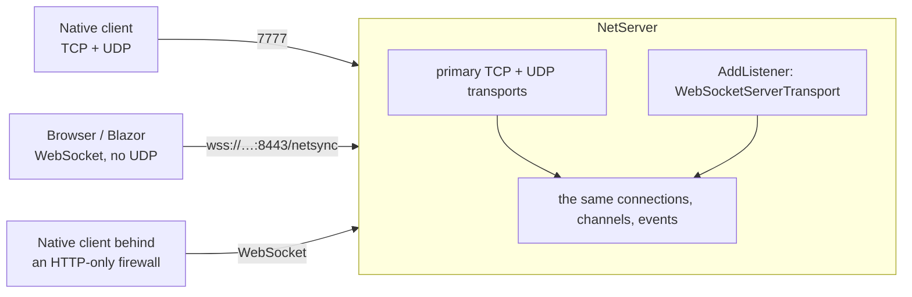

# Browsers and WebSocket

```csharp
var server = new NetServer(config);
var webSocket = new WebSocketTransportFactory { Path = "/netsync", ServerCertificate = cert }; // cert → wss://
webSocket.AllowedOrigins.Add("https://game.example.com");
server.AddListener(TransportType.Tcp, webSocket, 8443);   // browsers and HTTP-only networks
await server.StartAsync(7777);                           // native clients keep TCP+UDP here
```



- All listeners feed the same connections and events ([[NetServer]] `AddListener`, [[NetListener]]).
- A client without UDP sockets (browser) carries its UDP channels over the WebSocket automatically — the channel table stays identical everywhere ([[Connecting and approval#When UDP is blocked]]).
- The server does its own HTTP upgrade on a `TcpListener` (TLS optional, Origin allow-list, bounded handshake time) — [[WebSocketServerTransport]], [[WebSocketHandshake]]. Packets travel as binary messages through [[MessageLink]].
- Client side (.NET, including Blazor WebAssembly): `config.TransportFactories[TransportType.Tcp] = new WebSocketTransportFactory { UseTls = true, HostName = "game.example.com" }` — [[WebSocketClientTransport]].

## Status

| Client | Status |
|---|---|
| .NET over WebSocket (desktop, Blazor WASM) | works |
| JavaScript / TypeScript in the browser | planned as a separate package ([[Roadmap]]) |
| Unity WebGL | not supported until the JS client exists (no `System.Net.WebSockets` there) |

Sample: [[Samples#WebSocket]].
