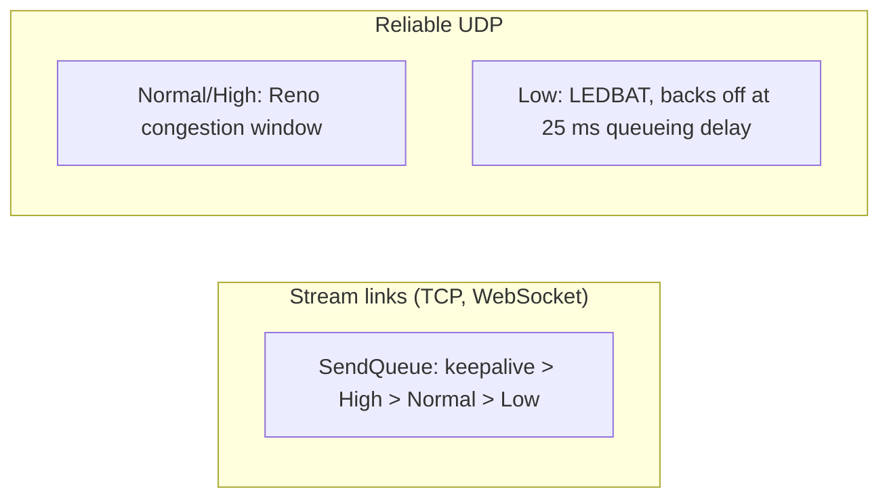

# Channels and delivery modes

A channel is a byte id mapped to a transport slot plus options ([[NetConfig]] → `ChannelConfig`). Everything is opt-in; a plain channel costs nothing extra.

```csharp
config.Channels[3] = new ChannelConfig(TransportType.Udp, ReliabilityMode.ReliableOrdered,
                                       compression: true, encryption: true, priority: ChannelPriority.Low);
```

## Delivery modes (UDP channels)

| Mode | Guarantees | Typical use | Size limit |
|---|---|---|---|
| `Unreliable` | none — raw datagram | voice, sensor data | one datagram (~1.1 KB) |
| `UnreliableSequenced` | stale packets dropped, no retransmit | positions, snapshots | one datagram |
| `UnreliableFragmented` | any size, whole message or nothing, stale dropped | video frames | `MaxMessageSize` |
| `Reliable` | exactly once, any order | events that must arrive | `MaxMessageSize` |
| `ReliableOrdered` | exactly once, in order | files, RPC, big messages | `MaxMessageSize` |

TCP channels are inherently reliable-ordered. `MaxMessageSize` (16 MB default) is enforced on both sides. How the modes work: [[Reliable UDP]], [[ReliabilityMode]].

## Priorities



- On stream links priorities order the [[SendQueue]].
- On reliable UDP each channel has its own congestion window; `Low` channels use delay-based control and yield to real-time traffic ([[CongestionControl]]). On a simulated 2 MB/s link a `Normal` bulk transfer adds ~120 ms to real-time packets, a `Low` one ~20 ms.
- Priority is a sender-side policy, not part of the handshake.

## Compression and encryption

`compression: true` deflates payloads ≥ 128 B when it helps (flagged per packet, [[Compressor]]). `encryption: true` encrypts with the connection's cipher suite and needs a key exchange ([[Security]]). Both run in [[ChannelTransform]] before reliability and fragmentation, which see opaque bytes.

## Mapping in code

[[NetClient]]/[[NetServer]] → `Route`: stream slot or UDP `Unreliable` → cached `[MsgData][channel]` prefix to the link; other UDP modes → [[ReliableEndpoint]]. See [[Send path]].
