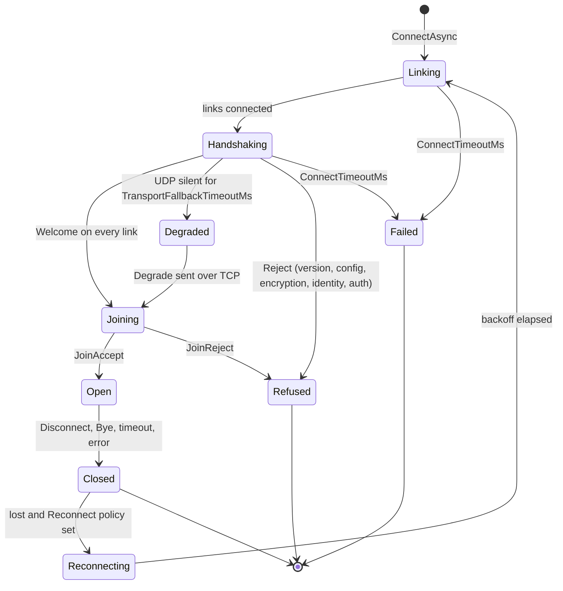

# Connecting and approval

```csharp
// Client: connect data (login token, version…), encrypted whenever a key exchange is configured.
await client.ConnectAsync("game.example.com", 7777, Encoding.UTF8.GetBytes(loginToken));

// Server: decide before the connection opens; refusals reach the client with your reason.
server.ConnectionApprover = async request => {
    var player = await accounts.CheckTokenAsync(request.ConnectData);
    if (player == null) return ConnectionDecision.Reject("invalid login");
    request.Connection.Tag = player;
    return ConnectionDecision.Accept();
};
serverConfig.MaxConnections = 500;   // "server full" beyond it
```

Types: [[ConnectionApproval]] (`ConnectionRequest`, `ConnectionDecision`, `ConnectionApprover`, `ConnectionRejectedException`).

## Client connection lifecycle



- `ConnectTimeoutMs` (10 s) bounds the **whole** `ConnectAsync`, the links' own connects included.
- Refusals throw `ConnectionRejectedException` with `Rejection` (ProtocolVersion, Encryption, Configuration, Authentication, ServerIdentity, Application) and `Reason`.
- The server raises `ConnectionOpened` before it sends `JoinAccept`, so nothing the client sends can arrive before the event.
- `MaxConnections` is reserved *before* the approver runs: simultaneous joins can't overshoot it.

Protocol details: [[Handshake v3]].

## When UDP is blocked

If TCP connects but UDP doesn't within `TransportFallbackTimeoutMs` (3 s), or UDP can't even be created (a browser), the connection still opens and UDP channels ride TCP — `client.IsDegraded` / `connection.IsDegraded`. Set `RequireAllTransports = true` to fail instead.

## Reconnects, kicks, statistics

```csharp
config.Reconnect = new ReconnectPolicy { MaxAttempts = 10 };   // backoff with jitter
client.Reconnecting += attempt => ShowSpinner(attempt);
client.Disconnected += reason => { if (reason == DisconnectReason.Kicked) ShowKickedScreen(); };
await server.Connections.First().DisconnectAsync();            // kick: Bye on every link
Console.WriteLine(client.Statistics);                          // messages, bytes, ping, RTT, retransmits
```

Auto-reconnect follows timeouts, errors and server restarts — never your own `Disconnect()`, a kick, or a refusal retrying can't fix. Each reconnect is a new connection on the server. [[DisconnectReason]], [[NetStatistics]].
