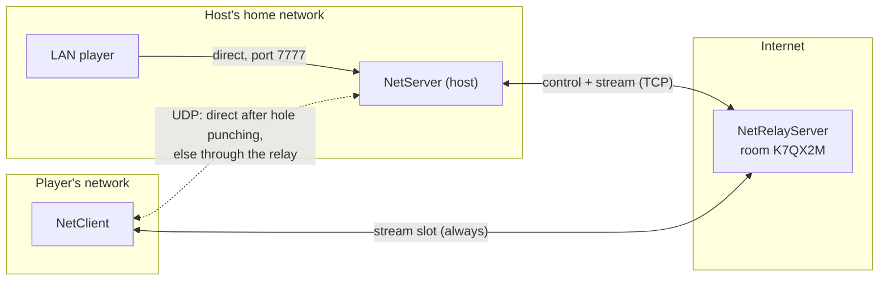

# Relay and NAT traversal

A player-hosted server behind a home router can't accept connections from the internet. [[NetRelayServer]] — run anywhere with a public address — gives it a **room**; players join by room code.

```csharp
// The relay
using var relay = new NetRelayServer();
await relay.StartAsync(7000);

// The host (behind NAT): keeps serving LAN clients directly, adds the room as extra listeners
var room = new RelayRoom(RelayRoom.NewRoomCode()) { RelayEndPoint = relayEndPoint };
server.AddListener(TransportType.Tcp, room.Tcp, 0);
server.AddListener(TransportType.Udp, room.Udp, 0);
await server.StartAsync(7777);

// A player
var join = new RelayRoom("K7QX2M");
clientConfig.TransportFactories[TransportType.Tcp] = join.Tcp;
clientConfig.TransportFactories[TransportType.Udp] = join.Udp;
await client.ConnectAsync("relay.example.com", 7000);
```



## What travels where

| Traffic | Path |
|---|---|
| Stream slot (TCP channels) | always through the relay (TCP can't be hole-punched reliably) |
| Datagram slot (UDP channels) | direct after hole punching; through the relay when the NATs don't allow it (two symmetric NATs), or when the direct path goes quiet |
| Everything | end-to-end encrypted and authenticated when a key exchange is set — the relay forwards envelopes it can't read |

**All traffic direct:** configure only UDP channels (`ReliableOrdered` replaces TCP) and register only `room.Udp` — tested with 0 bytes through the relay.

**Relay restarts:** the host reclaims its room in the background (0.5 → 30 s backoff); clients reconnect through their own `ReconnectPolicy`.

How it works: [[Relay internals]]. Modules: [[RelayRoom]], [[RelayHostSession]], [[RelayStreamTransports]], [[RelayDatagramTransports]], [[RelayProtocol]]. Sample: [[Samples#Relay]].
