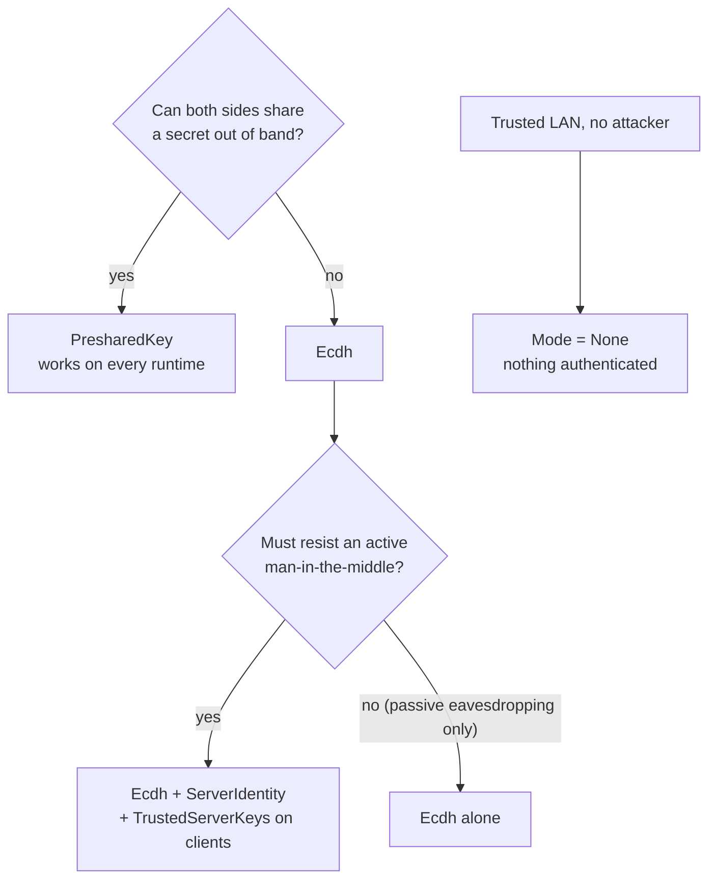

# Security

```csharp
config.Encryption = new EncryptionConfig {
    Mode = KeyExchangeMode.PresharedKey,   // or KeyExchangeMode.Ecdh
    PresharedKey = my32ByteKey
};
config.Channels[0] = new ChannelConfig(TransportType.Tcp, encryption: true);
```

A key exchange gives the **whole connection** integrity; channels marked `encryption: true` also get confidentiality.

| Protection | How | Where |
|---|---|---|
| Every packet authenticated | AES-GCM (GMAC) or HMAC-SHA256 tag, per-direction keys, replay window | [LinkSecurity](../Code/Pipeline/Security/LinkSecurity.md) |
| Payload confidentiality | AES-256-GCM or AES-256-CBC per channel | [ConnectionCrypto](../Code/Pipeline/Security/ConnectionCrypto.md), [ChannelTransform](../Code/Peers/ChannelTransform.md) |
| Suite negotiation | best common suite, part of the key derivation (no downgrade) | [CipherSuite](../Code/Pipeline/Security/CipherSuite.md) |
| Server authenticity | the identity key is mixed into the session keys, clients pin keys | [NetIdentity](../Code/Pipeline/Security/NetIdentity.md) |
| Connect data | encrypted with the session keys | [Handshake v4](../3%20Internals/Handshake%20v4.md) |
| Who gets in | `ConnectionApprover`, `MaxConnections` | [Connecting and approval](Connecting%20and%20approval.md) |
| Spoofing, floods | stream links create connections, cookies for UDP-only servers, trust mode, caps | [Limits and hardening](../3%20Internals/Limits%20and%20hardening.md) |

## Choosing a mode



## Server identity

```csharp
using var identity = NetIdentity.Generate();          // once; store ExportPrivateKey() in a secret store
serverConfig.Encryption = new EncryptionConfig { Mode = KeyExchangeMode.Ecdh, ServerIdentity = identity };

clientConfig.Encryption = new EncryptionConfig { Mode = KeyExchangeMode.Ecdh };
clientConfig.Encryption.TrustedServerKeys.Add(identity.PublicKey);  // ship with the app; several keys = rotation
```

A server that can't prove one of the pinned keys is refused with `ConnectionRejection.ServerIdentity`. A wrong pre-shared key fails fast with `ConnectionRejection.Authentication`. Details: [Keys and envelope](../3%20Internals/Keys%20and%20envelope.md), sample: [SecureLogin](Samples.md#securelogin).

## Threat model

- Hello/Welcome are plaintext, but every value in them is part of the key derivation: altering one in transit leaves the two sides with different keys and the connection never opens.
- ECDH without pinning stops passive eavesdropping only.
- Ping/pong is not authenticated (it only affects RTT measurement and liveness).
- `Mode = None` authenticates nothing — fine on a trusted LAN, not on the internet.
- Every keyed mode runs an ephemeral X25519 exchange implemented by the library itself, so all modes work on every runtime (Unity Mono and IL2CPP included), sessions can't be replayed, and past sessions stay private if a key leaks later.
- A pre-shared key that ships inside a client is known to everyone who has the client: it keeps outsiders out, it does not tell your users apart. Use `Ecdh` with a pinned server identity plus a login in the connect data for that.
