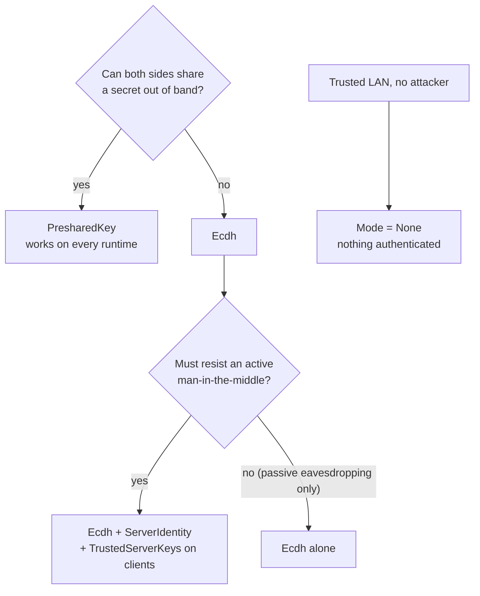

# Security

```csharp
config.Encryption = new EncryptionConfig {
    Mode = KeyExchangeMode.PresharedKey,   // or KeyExchangeMode.Ecdh
    PresharedKey = my32ByteKey
};
config.Channels[0] = new ChannelConfig(TransportType.Tcp, encryption: true);
```

A key exchange gives the **whole connection** integrity; channels marked `encryption: true` also get confidentiality.

| Protection | How | Where |
|---|---|---|
| Every packet authenticated | AES-GCM (GMAC) or HMAC-SHA256 tag, per-direction keys, replay window | [[LinkSecurity]] |
| Payload confidentiality | AES-256-GCM or AES-256-CBC per channel | [[ConnectionCrypto]], [[ChannelTransform]] |
| Suite negotiation | best common suite, part of keys and signature (no downgrade) | [[CipherSuite]] |
| Server authenticity | ECDSA identity signs every handshake, clients pin keys | [[NetIdentity]] |
| Connect data | encrypted with the session keys | [[Handshake v3]] |
| Who gets in | `ConnectionApprover`, `MaxConnections` | [[Connecting and approval]] |
| Spoofing, floods | stream links create connections, cookies for UDP-only servers, trust mode, caps | [[Limits and hardening]] |

## Choosing a mode



## Server identity

```csharp
using var identity = NetIdentity.Generate();          // once; store ExportPrivateKey() in a secret store
serverConfig.Encryption = new EncryptionConfig { Mode = KeyExchangeMode.Ecdh, ServerIdentity = identity };

clientConfig.Encryption = new EncryptionConfig { Mode = KeyExchangeMode.Ecdh };
clientConfig.Encryption.TrustedServerKeys.Add(identity.PublicKey);  // ship with the app; several keys = rotation
```

A server that can't prove one of the pinned keys is refused with `ConnectionRejection.ServerIdentity`. A wrong pre-shared key fails fast with `ConnectionRejection.Authentication`. Details: [[Keys and envelope]], sample: [[Samples#SecureLogin]].

## Threat model

- Hello/Welcome are plaintext; Welcome is signed when the server has an identity.
- ECDH without pinning stops passive eavesdropping only.
- Ping/pong is not authenticated (it only affects RTT measurement and liveness).
- `Mode = None` authenticates nothing — fine on a trusted LAN, not on the internet.
- ECDH and identity need P-256 (`ECDiffieHellman`/`ECDsa`), missing on some Mono/IL2CPP builds: check `NetIdentity.IsSupported`, or use `PresharedKey`.
