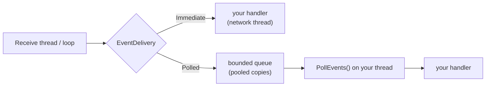

# Threading and events

All networking runs on background threads. You choose where your handlers run:

| `EventDelivery` | Handlers run | Use when | Cost |
|---|---|---|---|
| `Polled` (default) | inside `client.PollEvents()` / `server.PollEvents()` on your thread | game loops, UI threads, anything single-threaded | data copied into a pooled buffer, no allocation; queue bounded by `MaxPendingEvents` |
| `Immediate` | on network threads, as packets arrive | servers, lowest latency | none — handlers see the network buffer |

- `SendAsync` is safe from any thread in both modes.
- In Polled mode, data beyond `MaxPendingEvents` is dropped with a warning (`Statistics.DroppedEvents`) — connect/disconnect events never are.
- In Immediate mode keep handlers short: a slow handler holds up that link's receive loop.
- Handler exceptions are caught and logged, never propagated into network threads.

Module: [[EventDispatcher]]. Thread inventory and locking rules: [[Threads and loops]].
