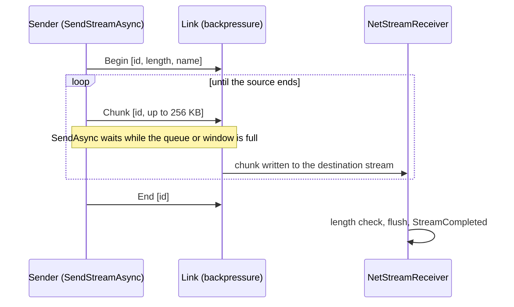

# Typed messages and streams

## Typed messages

```csharp
public struct Chat : INetMessage {
    public string Author, Text;
    public void Write(NetWriter w) => w.WriteString(Author).WriteString(Text);
    public void Read(NetReader r) { Author = r.ReadString(); Text = r.ReadString(); }
}

var registry = new NetMessageRegistry().Register<Chat>(1);   // same ids on both sides
var serverMessenger = new NetServerMessenger(server, registry);
serverMessenger.On<Chat>((connection, chat) => _ = serverMessenger.BroadcastAsync(0, chat));
var messenger = new NetClientMessenger(client, registry);
messenger.On<Chat>(chat => Console.WriteLine($"{chat.Author}: {chat.Text}"));
await messenger.SendAsync(0, new Chat { Author = "Anna", Text = "hi" });
```

- Wire format `[id: var-uint][body]`; no reflection (IL2CPP/AOT-safe).
- Struct messages cost **no allocation** either way: sends serialize into a per-thread writer, dispatch reads a copy-on-write handler table without locks.
- Unknown ids and malformed bodies raise `UnknownMessage` / `MalformedMessage` instead of throwing.

Modules: [[NetMessages]] (`INetMessage`, `NetMessageRegistry`, `MessageDispatcher`, messengers), [[NetWriter]], [[NetReader]].

## Serialization primitives

[[NetWriter]] / [[NetReader]]: little-endian primitives, LEB128 var-ints (ZigZag for signed), length-prefixed UTF-8, GUIDs. The reader throws only `EndOfStreamException` on truncated or hostile input — any length prefix beyond the remaining bytes included.

## Streams: files of any size

```csharp
await client.SendStreamAsync(channel: 3, File.OpenRead("level.pak"), name: "level.pak");

var receiver = new NetStreamReceiver(info => File.Create(Path.Combine(downloads, Path.GetFileName(info.Name))));
receiver.StreamCompleted += info => Console.WriteLine($"got {info.Name}");
server.MessageReceived += (conn, channel, data) => { if (channel == 3) receiver.HandleMessage(data); };
```



- Memory stays at a few MB: backpressure of the [[SendQueue]] or the reliable window paces the reader.
- Use an ordered reliable channel dedicated to streams, ideally `ChannelPriority.Low`.
- The receiver opens at most `MaxActiveStreams` (16) at once (`StreamRefused` beyond), ends a stream with `StreamFailed` when the destination can't be written, and the name comes from the remote — sanitize it.

Module: [[NetStreams]]. Sample: [[Samples#FileTransfer]].
