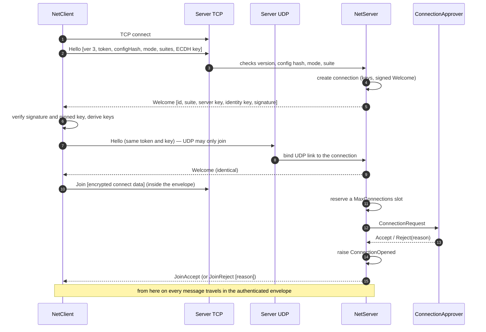
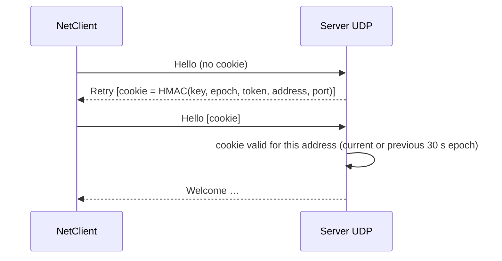

# Handshake v3

## TCP + UDP server

- Hello is resent every 200 ms until Welcome (datagrams get lost; duplicates are idempotent). Join is resent every 300 ms.
- A mismatch at step 3 → `Reject [reason]` → `ConnectionRejectedException` (ProtocolVersion, Configuration, Encryption).
- If UDP stays silent for `TransportFallbackTimeoutMs`, the client sends `Degrade` over TCP instead and the connection opens without UDP ([[Connecting and approval#When UDP is blocked]]).
- Envelopes that fail verification before the connection opens mean different keys (wrong PSK) → `Reject(Authentication)` once, then close.

## UDP-only server: cookie first

No keys are generated and no connection exists until the client has proven it receives at its source address — spoofed Hellos cost the server one HMAC.

## Rules

| Rule | Why |
|---|---|
| Only stream links (TCP, WebSocket) create connections; UDP joins | UDP source addresses are trivially forged |
| ≤ 1024 handshakes pending | flood insurance |
| A bound slot is never re-bound by another address | the token is plaintext; anyone who saw it could hijack the link |
| Later Hellos must carry the same ECDH key | same token from someone else is not the same client |
| Welcome built once, identical on every link | the identity signature is costly |
| `ConnectionOpened` before `JoinAccept` | nothing the client sends can arrive ahead of the event |

Code: [[NetClient]] (`NetClient.Connect.cs`: `ConnectCoreAsync`, `SendHelloLoopAsync`, `HandleWelcome`, `EstablishKeys`, `JoinAsync`), [[NetServer]] (`NetServer.Handshake.cs`: `HandleHello`, `MayCreateConnection`, `ComputeCookie`, `CreateConnection`, `HandleJoin`, `ApproveAsync`, `TryTakeSlot`), [[PeerProtocol]], [[ConnectionApproval]]. Byte layouts: [[Wire protocol]].
