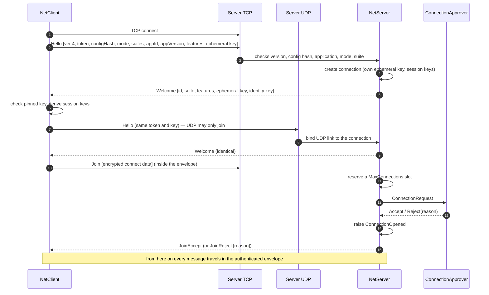
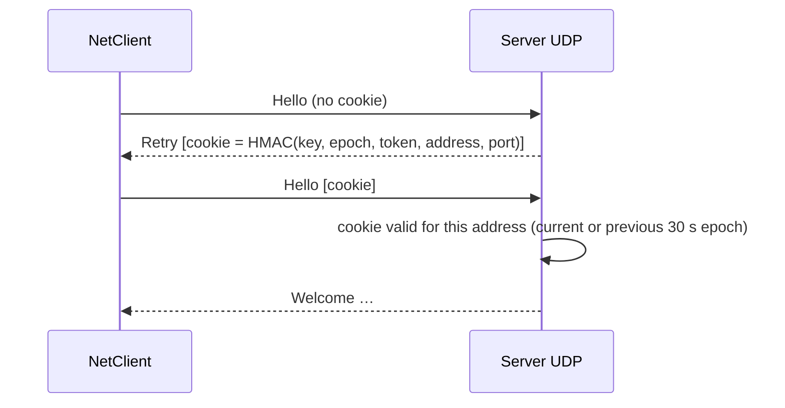

# Handshake v4

Protocol v4 is the stable wire contract: v4 peers interoperate with every later release. New capabilities are added through the extension points below, never by changing what is described here. The exact bytes are pinned by `ProtocolV4VectorsTests` and reproduced independently by `tools/protocol-v4-vectors.py`.

## TCP + UDP server



- Hello is resent every 200 ms until Welcome (datagrams get lost; duplicates are idempotent). Join is resent every 300 ms.
- A mismatch at step 3 → `Reject [reason]` → `ConnectionRejectedException` (ProtocolVersion, Configuration, ApplicationMismatch, Encryption).
- If UDP stays silent for `TransportFallbackTimeoutMs`, the client sends `Degrade` over TCP instead and the connection opens without UDP ([When UDP is blocked](../2%20Guides/Connecting%20and%20approval.md#when-udp-is-blocked)).
- The connection opens only after Join and JoinAccept have crossed inside the envelope: that exchange is what confirms both sides hold the same keys. Envelopes that fail verification while connecting mean the keys differ — a wrong pre-shared key (`Authentication`) or a server that does not hold the identity it presented (`ServerIdentity`).

## Messages

| Message | Layout |
|---|---|
| Hello `0x01` | `[ver=4][token:8][configHash:4][keyExchange:1][suites:1][appId:8][appVersion:2][features:4][pubLen:1][pub…][cookieLen:1][cookie…][extLen:2][extensions…]` |
| Welcome `0x02` | `[connectionId:8][suite:1][features:4][pubLen:1][pub…][idLen:1][identityKey…][extLen:2][extensions…]` |

`pub` is an ephemeral X25519 public key (32 bytes) in the keyed modes and empty in `None`. `identityKey` is the server's long-term X25519 public key, present when the server has a `ServerIdentity`. `appId` is the first 8 bytes of SHA-256 of `NetConfig.AppId` (0 when empty). All integers are big-endian.

## Growing without a new version

| Extension point | Rule |
|---|---|
| `features` (32 bits) | The client sends what it supports, the server answers with the bits both sides know. A bit nobody defined yet is ignored. |
| `extensions` | A block of `[type:1][length:2][value]` entries. A receiver skips types it does not know. |
| `suites` (8 bits) | Cipher suites as a bitmask: a new suite is a new bit. |
| Formats after the handshake | May change only under a feature bit both sides agreed on. |

Feature bits:

| Bit | Meaning | Since |
|---|---|---|
| 0 | Reserved: a connection id in the datagram envelope, for clients whose address changes. | — |
| 1 | Reserved: an extended reliability format (larger window, acknowledgements carried with data). | — |
| 2 | Losing UDP mid-session moves the UDP channels to the stream link instead of closing. Either side sends Degrade over the stream link; both move their reliability layer there, resend what is unacknowledged and only then send newer messages of those channels as plain Data. | 2.0.0-rc.6 |

## Session keys

Every keyed connection runs an ephemeral X25519 exchange, so both sides put fresh randomness into every session: bytes recorded from one session are meaningless in another, and past sessions stay private if a long-term secret leaks later.

```
ee      = X25519(client ephemeral, server ephemeral)
es      = X25519(client ephemeral, server identity)      only with a server identity
secret  = HKDF-SHA256(salt = SHA-256(transcript),
                      ikm  = ee ‖ es ‖ presharedKey,     absent parts are empty
                      info = "NetSync/4 session", 32 bytes)
```

What authenticates the exchange is part of the key material itself: only a holder of the pre-shared key, or of the identity's private key, arrives at the same `secret`. No signatures are involved.

`transcript = "NetSync/4 handshake" ‖ token ‖ configHash ‖ keyExchange ‖ offeredSuites ‖ appId ‖ appVersion ‖ offeredFeatures ‖ len ‖ clientKey ‖ chosenSuite ‖ agreedFeatures ‖ len ‖ serverKey ‖ len ‖ identityKey` — every negotiated value, so none can be altered in transit without the two sides ending up with different keys. Per-direction keys are then derived from `secret` ([Keys and envelope](Keys%20and%20envelope.md)).

The key exchange is the library's own code ([X25519](../Code/Pipeline/Security/X25519.md), checked against RFC 7748), so it behaves the same on every runtime, Unity included.

## UDP-only server: cookie first



No keys are generated and no connection exists until the client has proven it receives at its source address — spoofed Hellos cost the server one HMAC.

## Rules

| Rule | Why |
|---|---|
| Only stream links (TCP, WebSocket) create connections; UDP joins | UDP source addresses are trivially forged |
| ≤ 1024 handshakes pending | flood insurance |
| A bound slot is never re-bound by another address | the token is plaintext; anyone who saw it could redirect the link |
| Later Hellos must carry the same ephemeral key | same token from someone else is not the same client |
| Welcome built once, identical on every link | one key exchange per connection |
| `ConnectionOpened` before `JoinAccept` | nothing the client sends can arrive ahead of the event |

Code: [NetClient](../Code/Peers/NetClient.md) (`NetClient.Connect.cs`: `ConnectCoreAsync`, `SendHelloLoopAsync`, `HandleWelcome`, `EstablishKeys`, `JoinAsync`), [NetServer](../Code/Peers/NetServer.md) (`NetServer.Handshake.cs`: `HandleHello`, `MayCreateConnection`, `ComputeCookie`, `CreateConnection`, `HandleJoin`, `ApproveAsync`), [PeerProtocol](../Code/Peers/PeerProtocol.md), `HandshakeKeys`.
