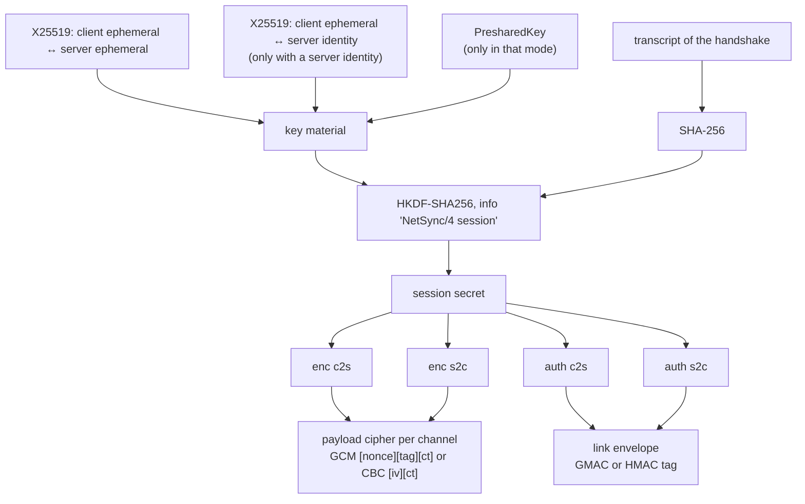

# Keys and envelope

## Key schedule

How the session secret comes about: [Session keys](Handshake%20v4.md#session-keys). Every key is `HMAC-SHA256(secret, "NetSync/4 <purpose> <direction> <suite>")`. Per direction: a peer never authenticates with the key it verifies with (no reflection), and GCM nonces can't collide between directions. The suite is in every label: peers that disagree get unrelated keys and fail at the first packet. — [ConnectionCrypto](../Code/Pipeline/Security/ConnectionCrypto.md)

## Cipher suites

| Suite | Envelope tag | Payload | Chosen when |
|---|---|---|---|
| `AesGcm` | GMAC, nonce = slot ‖ 000 ‖ counter | AES-256-GCM, per-direction counter nonce | both sides net8.0 with AES-GCM support |
| `AesCbcHmacSha256` | HMAC-SHA256(slot ‖ counter ‖ inner)[0..16] | AES-256-CBC, random IV (the envelope authenticates it) | otherwise (netstandard2.1, Unity) |

The client offers a bitmask, the server picks the best common suite — [CipherSuite](../Code/Pipeline/Security/CipherSuite.md).

## Envelope

`[MsgSecure 0x40][counter:8 BE][tag:16][inner peer message]` — [LinkSecurity](../Code/Pipeline/Security/LinkSecurity.md)

- Covers what payload encryption can't: channel, flags, sequence numbers, whole ACK/Bye/Degrade messages. Without it a forged ACK could make a "reliable" channel lose data (a test shows the attack working without authentication and failing with it).
- The slot (TCP/UDP) is part of the tag: packets can't be moved between links.
- 1024-packet sliding replay window; it advances only after the tag verifies, so forged counters can't push real packets out.

## Server identity

A long-term X25519 key pair ([NetIdentity](../Code/Pipeline/Security/NetIdentity.md)). The server sends the public key in Welcome and mixes an exchange between it and the client's ephemeral key into the session keys; a client with `TrustedServerKeys` accepts only a pinned key. A server that presents a pinned key without holding its private key derives different session keys, so its packets never verify and the client fails with `ServerIdentity`. Because the whole transcript is part of the derivation, neither the keys nor the suite choice can be swapped in transit.

Guide: [Security](../2%20Guides/Security.md). Handshake: [Handshake v4](Handshake%20v4.md).
