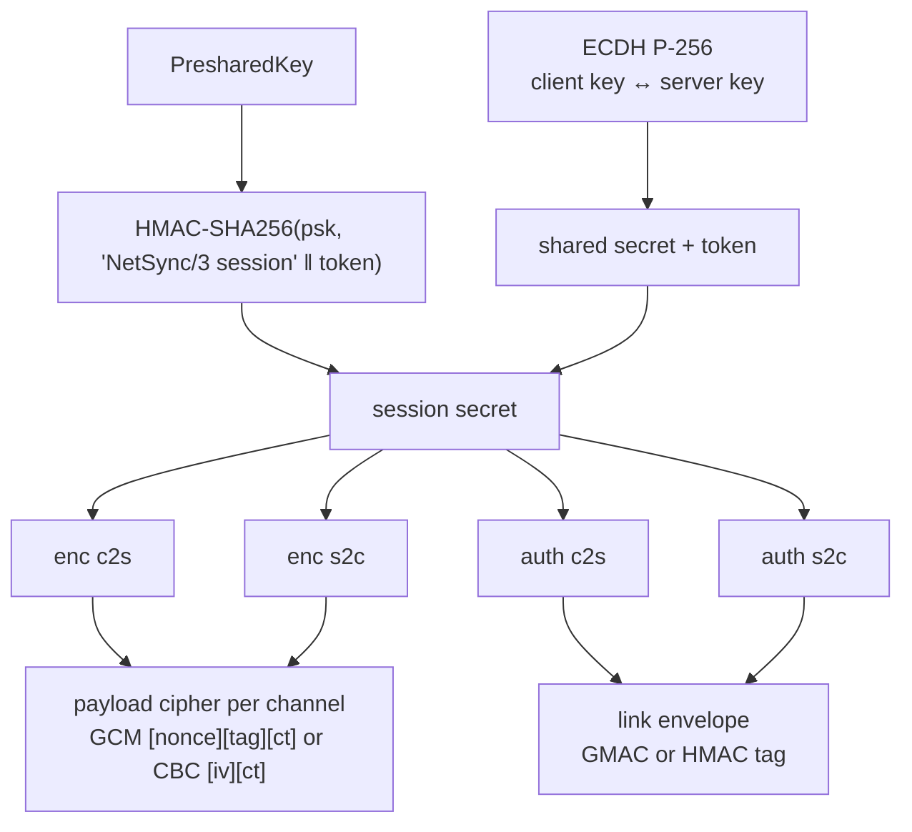

# Keys and envelope

## Key schedule

Every key is `HMAC-SHA256(secret, "NetSync/3 <purpose> <direction> <suite>")`. Per direction: a peer never authenticates with the key it verifies with (no reflection), and GCM nonces can't collide between directions. The suite is in every label: peers that disagree get unrelated keys and fail at the first packet. — [[ConnectionCrypto]], [[EcdhKeyExchange]]

## Cipher suites

| Suite | Envelope tag | Payload | Chosen when |
|---|---|---|---|
| `AesGcm` | GMAC, nonce = slot ‖ 000 ‖ counter | AES-256-GCM, per-direction counter nonce | both sides net8.0 with AES-GCM support |
| `AesCbcHmacSha256` | HMAC-SHA256(slot ‖ counter ‖ inner)[0..16] | AES-256-CBC, random IV (the envelope authenticates it) | otherwise (netstandard2.1, Unity) |

The client offers a bitmask, the server picks the best common suite — [[CipherSuite]].

## Envelope

`[MsgSecure 0x40][counter:8 BE][tag:16][inner peer message]` — [[LinkSecurity]]

- Covers what payload encryption can't: channel, flags, sequence numbers, whole ACK/Bye/Degrade messages. Without it a forged ACK could make a "reliable" channel lose data (a test shows the attack working without authentication and failing with it).
- The slot (TCP/UDP) is part of the tag: packets can't be moved between links.
- 1024-packet sliding replay window; it advances only after the tag verifies, so forged counters can't push real packets out.

## Server identity

ECDSA P-256 ([[NetIdentity]]) signs `"NetSync/3 server identity" ‖ token ‖ configHash ‖ keyExchange ‖ offeredSuites ‖ chosenSuite ‖ clientKey ‖ serverKey`. The signature binds the ECDH keys *and* the suite choice: a man-in-the-middle can neither substitute keys nor downgrade. Clients with `TrustedServerKeys` accept only those keys; fingerprints are `SHA256:xx:…`.

Guide: [[Security]]. Handshake: [[Handshake v3]].
