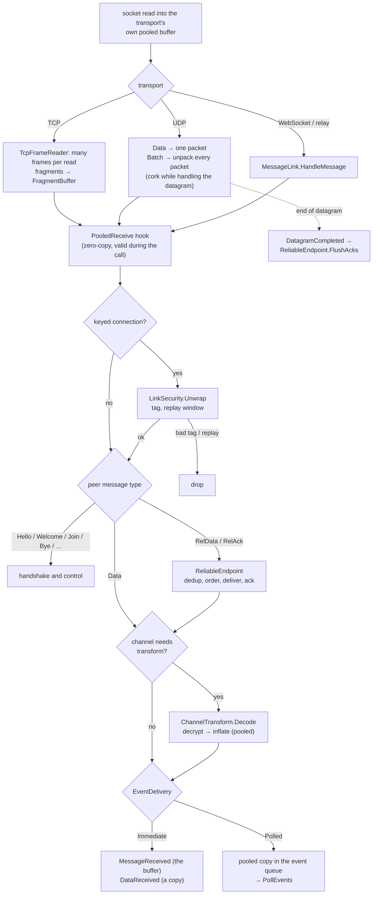

# Receive path

## Rules

- **Exactly one copy for anything kept**: transports deliver their own buffer; the reliability layer copies only out-of-order packets it must hold; Polled delivery copies into a pooled buffer.
- **Anything invalid is dropped**, never delivered as garbage or thrown into network threads ([[Limits and hardening]]).
- **Order of checks** on keyed connections: envelope first — nothing parses an unauthenticated packet.
- **Replies leave together**: while the UDP receive thread handles a datagram, its own sends (acks, echoes) are corked and the collapsed acks are flushed at the end ([[UDP batching]], [[Reliable UDP]]).

Code: [[TcpFrameReader]], [[UdpTransport]], [[UdpServerTransport]], [[DatagramBatcher]] (`Unpack`), [[MessageLink]], [[TransportCapabilities]] (`ReceivedPacket.Deliver`), [[LinkSecurity]], [[ReliableEndpoint]], [[ChannelTransform]], [[EventDispatcher]], [[NetClient]], [[NetServer]].
