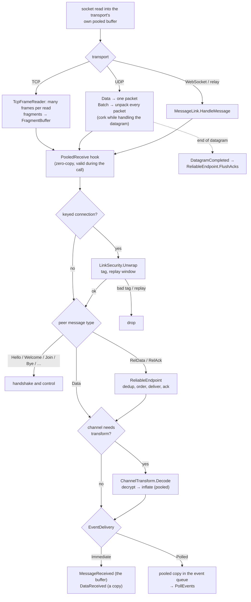

# Receive path

## Rules

- **Exactly one copy for anything kept**: transports deliver their own buffer; the reliability layer copies only out-of-order packets it must hold; Polled delivery copies into a pooled buffer.
- **Anything invalid is dropped**, never delivered as garbage or thrown into network threads ([Limits and hardening](Limits%20and%20hardening.md)).
- **Order of checks** on keyed connections: envelope first — nothing parses an unauthenticated packet.
- **Replies leave together**: while the UDP receive thread handles a datagram, its own sends (acks, echoes) are corked and the collapsed acks are flushed at the end ([UDP batching](UDP%20batching.md), [Reliable UDP](Reliable%20UDP.md)).

Code: [TcpFrameReader](../Code/Transports/Tcp/TcpFrameReader.md), [UdpTransport](../Code/Transports/Udp/UdpTransport.md), [UdpServerTransport](../Code/Transports/Udp/UdpServerTransport.md), [DatagramBatcher](../Code/Transports/Udp/DatagramBatcher.md) (`Unpack`), [MessageLink](../Code/Transports/MessageLink.md), [TransportCapabilities](../Code/Transports/TransportCapabilities.md) (`ReceivedPacket.Deliver`), [LinkSecurity](../Code/Pipeline/Security/LinkSecurity.md), [ReliableEndpoint](../Code/Pipeline/Reliability/ReliableEndpoint.md), [ChannelTransform](../Code/Peers/ChannelTransform.md), [EventDispatcher](../Code/Peers/EventDispatcher.md), [NetClient](../Code/Peers/NetClient.md), [NetServer](../Code/Peers/NetServer.md).
