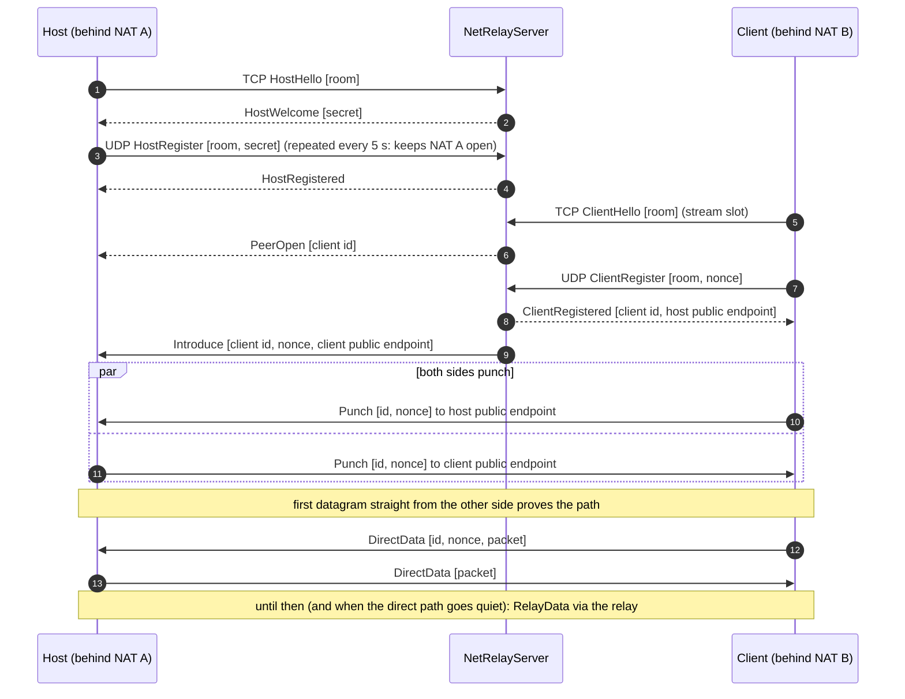

# Relay internals

## Registration and hole punching

- The nonce, introduced by the relay, authenticates direct packets: nobody else can inject data as that client. The host accepts peer-reflexive endpoints (the address the punch really came from).
- Two symmetric NATs can't be punched: UDP stays on the relay, still end to end encrypted.
- The stream slot always goes through the relay: PeerOpen / PeerData / PeerClose multiplex every stream client over the host's single control connection ([[RelayHostSession]], [[FramedConnection]]).
- **Relay restart**: when the host's control connection drops while the room is in use, [[RelayRoom]] reconnects with backoff (0.5 → 30 s) and raises `HostSessionRestored`; the host transports re-attach, the UDP side re-registers under the new secret and drops client records (ids restart on a new relay).

## Allocation-free forwarding

The relay and its transports receive into a reused `SocketAddress` and send to cached ones ([[EndPointCache]]): no allocation per datagram on net8.0 (netstandard2.1 lacks the APIs).

## Testing without real NATs

[[DatagramSocket]] is the seam: tests substitute port-restricted cone and symmetric NAT simulators and assert bytes through the relay (0 B with cone NATs after punching, everything with symmetric ones) — [[Tests]].

Modules: [[NetRelayServer]], [[RelayRoom]], [[RelayHostSession]], [[RelayStreamTransports]], [[RelayDatagramTransports]], [[RelayProtocol]], [[FramedConnection]], [[DatagramSocket]]. Guide: [[Relay and NAT traversal]].
