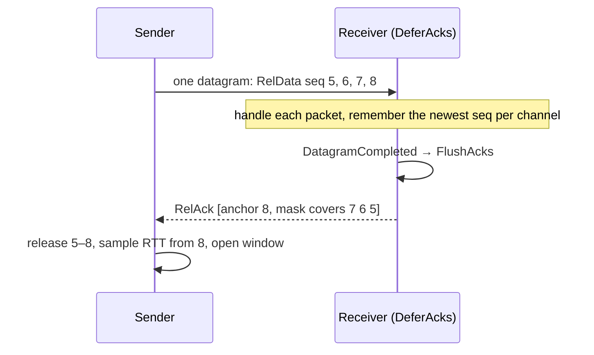

# Reliable UDP

One [[ReliableEndpoint]] per datagram link (client session or server connection). Per channel:

| Mechanism | Detail |
|---|---|
| Sequences | 16-bit, wrap-aware: `SeqDistance = (short)(a - b)`; tested past 65 535 |
| Modes | `UnreliableSequenced` (newest wins), `UnreliableFragmented` (whole message or nothing, stale dropped), `Reliable` (dedup ring), `ReliableOrdered` (+ reorder buffer) — [[ReliabilityMode]] |
| Send window | **range gate**: `NextSeq` ≤ oldest unacked + 256 — the receiver's 256-slot dedup ring breaks otherwise; cwnd is an *extra* gate on the in-flight count |
| RTT | RFC 6298 SRTT/RTTVAR from acks of never-retransmitted packets (Karn) + windowed base RTT — [[CongestionControl]] |
| RTO | SRTT + 4·RTTVAR (≥ 30 ms), exponential backoff, 12 attempts → link dead |
| Fast retransmit | a packet ≥ 3 behind an acked one is resent at once |
| Congestion | per channel: Reno (slow start, +1/RTT, halve once per RTT on loss); `Low` priority → LEDBAT (grow only while queueing delay < 25 ms) |
| Fragments | above `FragmentSize` (1100 B, raised up to 1453 B by path-MTU discovery); reliable or unreliable |
| Timers | one process-wide [[ReliabilityClock]] thread scans every endpoint (5 ms tick, 10 ms per endpoint) |

## Acks

`RelAck [channel][anchorSeq][mask:4]` — the anchor plus a bitmask of the 32 seqs below it.

On links that report datagram boundaries ([[TransportCapabilities]] `IDatagramBoundaryTransport`), acks for one datagram collapse into one per channel, anchored on the newest seq and sent together with the replies to it. An ack the mask can't cover (≥ 32 apart) goes out immediately. Elsewhere every reliable packet is acked at once.

## Buffers

Pending packets live in pooled arrays. A retransmission may read one outside the lock while an ack removes it, so a buffer returns to the pool only when no send is reading it (`PendingPacket.InFlight`). Out-of-order packets held for ordering are the only receive-side copies.

## Numbers

Loopback echo with 64 messages in flight: ~0.2 M msg/s (was 62 k before batching and collapsed acks); bulk ~250 MB/s; 1 MB through a 5 %-loss proxy arrives intact; on a simulated 2 MB/s bottleneck 4.5 % retransmissions at ~92 % utilization. [[Benchmarks and performance]], [[Tests]].
