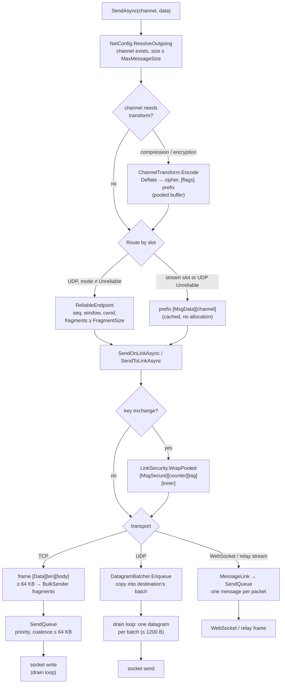

# Send path

`client.SendAsync(channel, data)` — the server side ([[NetConnection]] → [[NetServer]]) is the same with `SendToLinkAsync`.

## Rules this path keeps

- **Caller memory is read only before `SendAsync` returns.** Every copy happens synchronously (into a pooled frame, a batch, a reliable `PendingPacket`); bulk paths copy the rest the moment they would have to wait ([[BulkSender]], [[ReliableEndpoint]]).
- **No allocation per message**: cached prefixes, pooled buffers, struct jobs, `AsyncSignal` wake-ups ([[Pooled]], [[AsyncSignal]], [[SendQueue]], [[DatagramBatcher]]).
- **A lone message is never delayed**: queues wake their drain loop at once; batching only packs what arrives while a socket call is in progress ([[UDP batching]]).
- **Backpressure**: `SendQueue` fails fast for real-time sends when full, waits for bulk; reliable channels wait for window/cwnd; UDP batches are capped at 256 KB per destination (beyond = dropped, like a full socket buffer).

Code: [[NetClient]] (`SendAsync`, `Route`, `SendOnLinkAsync`), [[ChannelTransform]], [[PeerProtocol]] (`DataPrefix`), [[LinkSecurity]], [[PacketProtocol]], [[TcpTransport]], [[UdpTransport]], [[MessageLink]].
