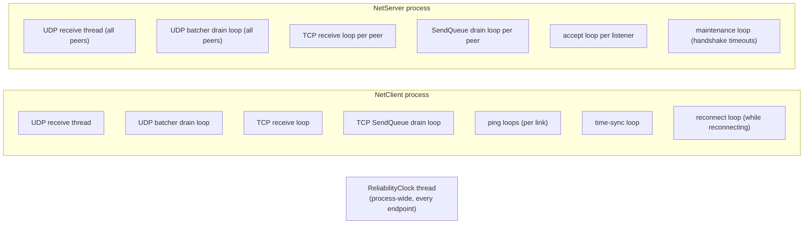

# Threads and loops

| Loop | Kind | Owner |
|---|---|---|
| UDP receive | dedicated thread, one reused buffer | [[UdpTransport]], [[UdpServerTransport]] |
| UDP send | async drain loop on `AsyncSignal` | [[DatagramBatcher]] |
| TCP / WebSocket receive | async loop, growable [[ReceiveBuffer]] | [[TcpTransport]], [[TcpServerTransport]], WebSocket transports |
| Stream send | async drain loop on `AsyncSignal` | [[SendQueue]] |
| Keepalive | async loop per transport (server: one for all peers) | transports |
| Retransmission | one thread for the whole process | [[ReliabilityClock]] |
| Accept | async loop per listener | [[TcpAcceptLoop]] |
| Handshake timeouts | async loop | [[NetServer]] |
| Clock sync, MTU probe, reconnect | async tasks | [[NetClient]] |

## Rules

- **Drain loops** wait on [[AsyncSignal]] (allocation-free, continuations on the pool): producers only pay for the enqueue; work arriving meanwhile is batched.
- **Reliability locking**: channel lock → RTT lock, always in that order; receiver state belongs to the link's receive thread.
- **LinkSecurity**: send side locked with an atomic counter; receive side single-threaded.
- **Buffer ownership**: a pooled buffer belongs to the queue/batcher from the moment it is enqueued — nothing may return it afterwards (a double return hands one array to two owners).
- **Fire-and-forget** sends go through `Forget()`/`ObserveFaults()` ([[TaskExtensions]]): free when synchronous, failures logged, never unobserved, continuations on the default scheduler (never a game engine's main-thread scheduler).
- **Events**: see [[Threading and events]].
