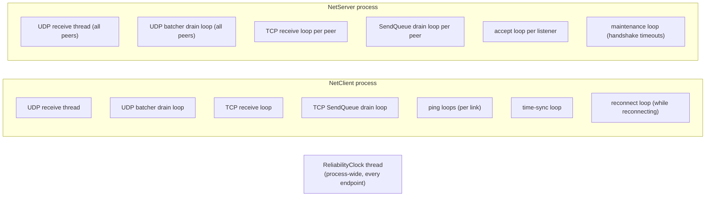

# Threads and loops

| Loop | Kind | Owner |
|---|---|---|
| UDP receive | dedicated thread, one reused buffer | [UdpTransport](../Code/Transports/Udp/UdpTransport.md), [UdpServerTransport](../Code/Transports/Udp/UdpServerTransport.md) |
| UDP send | async drain loop on `AsyncSignal` | [DatagramBatcher](../Code/Transports/Udp/DatagramBatcher.md) |
| TCP / WebSocket receive | async loop, growable [ReceiveBuffer](../Code/Transports/ReceiveBuffer.md) | [TcpTransport](../Code/Transports/Tcp/TcpTransport.md), [TcpServerTransport](../Code/Transports/Tcp/TcpServerTransport.md), WebSocket transports |
| Stream send | async drain loop on `AsyncSignal` | [SendQueue](../Code/Sending/SendQueue.md) |
| Keepalive | async loop per transport (server: one for all peers) | transports |
| Retransmission | one thread for the whole process | [ReliabilityClock](../Code/Pipeline/Reliability/ReliabilityClock.md) |
| Accept | async loop per listener | [TcpAcceptLoop](../Code/Transports/TcpAcceptLoop.md) |
| Handshake timeouts | async loop | [NetServer](../Code/Peers/NetServer.md) |
| Clock sync, MTU probe, reconnect | async tasks | [NetClient](../Code/Peers/NetClient.md) |

## Rules

- **Drain loops** wait on [AsyncSignal](../Code/Internal/AsyncSignal.md) (allocation-free, continuations on the pool): producers only pay for the enqueue; work arriving meanwhile is batched.
- **Reliability locking**: channel lock → RTT lock, always in that order; receiver state belongs to the link's receive thread.
- **LinkSecurity**: send side locked with an atomic counter; receive side single-threaded.
- **Buffer ownership**: a pooled buffer belongs to the queue/batcher from the moment it is enqueued — nothing may return it afterwards (a double return hands one array to two owners).
- **Fire-and-forget** sends go through `Forget()`/`ObserveFaults()` ([TaskExtensions](../Code/Internal/TaskExtensions.md)): free when synchronous, failures logged, never unobserved, continuations on the default scheduler (never a game engine's main-thread scheduler).
- **Events**: see [Threading and events](../2%20Guides/Threading%20and%20events.md).
