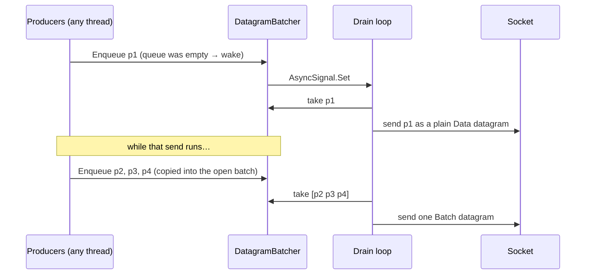

# UDP batching

On Windows loopback one datagram send costs ~7.5 µs — sending fewer datagrams is what makes UDP fast. [[DatagramBatcher]] packs small packets to the same destination into one datagram **without delaying anything**.

## Rules

- **No timer, no linger.** A lone packet leaves at once; batches form only from what queues during a socket call. A linger (waiting a few µs for more) was tried and rejected: no throughput gain, worse latency.
- **Wire**: a batch is `[0x12][len][packet][len][packet]…` (varint lengths), ≤ 1200 B (below the IPv6 minimum MTU); a batch with one packet is sent as a plain `[0x10][packet]` datagram — receivers see the old format. Bigger packets go alone, in order.
- **Cork**: the receive thread corks the batcher while it handles one datagram, so its replies (echoes, acks) leave together; packets from other threads are never held back.
- **Bounded**: 256 KB per destination; beyond that new packets are dropped (the reliability layer retransmits what matters).
- **Closing flushes**: closing a peer or transport sends what is already queued first (a Bye before a kick).
- **Untrusted sources**: a batch from a peer that hasn't completed the handshake gets one packet processed — no work amplification.
- One drain loop per transport: the UDP server serves all peers with one loop and one receive thread.

## Result

| Loopback echo, 64 in flight | Before | After |
|---|---|---|
| Unreliable | 101 k msg/s | 1.1–1.3 M msg/s |
| Reliable-ordered (with collapsed acks) | 62 k | 0.18–0.25 M |

Code: [[DatagramBatcher]], [[UdpTransport]], [[UdpServerTransport]], [[AsyncSignal]]. Related: [[Reliable UDP#Acks]].
