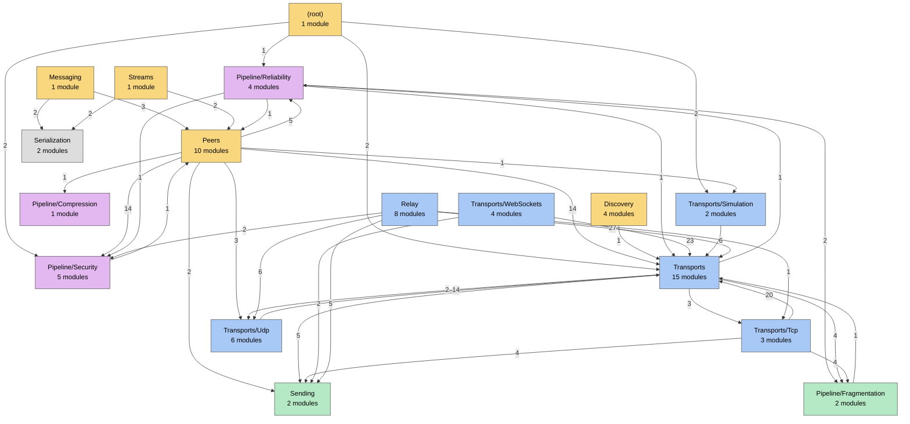

# Dependency overview

> [!info] Generated by `tools/generate-vault.py` from the source — do not edit by hand; rerun the script after code changes.

Folders of `src/NetSync` (≈ namespaces) and how many module-to-module references cross between them. Arrows point from the user to what it uses. Layers run top to bottom; an arrow pointing *up* is a dependency against the layering — worth a look when it appears.

Colour = layer: API, Session, Transports, Infrastructure, Foundation (top to bottom). References to the utility folders and to `(root)` — `NetConfig.cs`, which also declares the `TransportType` enum nearly everything names — are left out of the drawing:

| Folder | Used by folders (references) |
|---|---|
| (root) | Peers (8), Pipeline/Reliability (1), Pipeline/Security (1), Transports (1), Pipeline/Fragmentation (1) |
| Diagnostics | (root) (1), Peers (6), Discovery (2), Pipeline/Reliability (1), Pipeline/Compression (1), Transports (4), Transports/Tcp (3), Transports/Udp (4), Transports/WebSockets (3), Relay (7), Sending (1), Internal (1) |
| Internal | Peers (6), Pipeline/Reliability (3), Pipeline/Security (1), Pipeline/Compression (1), Transports (6), Transports/Tcp (4), Transports/Udp (6), Transports/WebSockets (1), Transports/Simulation (1), Relay (6), Sending (3), Pipeline/Fragmentation (2) |

## Dependencies against the layering

| From | To | References | Modules |
|---|---|---|---|
| Pipeline/Fragmentation | (root) | 1 | [[FragmentBuffer]] → [[NetConfig]] |
| Pipeline/Fragmentation | Transports | 1 | [[PacketFragmenter]] → [[PacketProtocol]] (`PacketType`) |
| Pipeline/Reliability | (root) | 1 | [[ReliableEndpoint]] → [[NetConfig]] (`ChannelConfig`, `NetConfig`, `TransportType`) |
| Pipeline/Reliability | Peers | 1 | [[ReliableEndpoint]] → [[PeerProtocol]] |
| Pipeline/Security | (root) | 1 | [[ConnectionCrypto]] → [[NetConfig]] (`TransportType`) |
| Pipeline/Security | Peers | 1 | [[LinkSecurity]] → [[PeerProtocol]] |
| Relay | Pipeline/Security | 2 | [[NetRelayServer]] → [[ConnectionCrypto]] [[RelayDatagramTransports]] → [[ConnectionCrypto]] |
| Transports | (root) | 1 | [[TransportSettings]] → [[NetConfig]] |
| Transports | Pipeline/Reliability | 1 | [[IPrioritizedTransport]] → [[ReliabilityMode]] (`ChannelPriority`) |

## Matrix

Module-to-module references from the row folder to the column folder (`T/` = Transports, `P/` = Pipeline). Above the diagonal = towards lower layers.

| from ↓ to → | (root) | Peers | Messaging | Streams | Discovery | P/Reliability | P/Security | P/Compression | Transports | T/Tcp | T/Udp | T/WebSockets | T/Simulation | Relay | Sending | P/Fragmentation | Serialization | Diagnostics | Internal |
|---|---|---|---|---|---|---|---|---|---|---|---|---|---|---|---|---|---|---|---|
| **(root)** | · |  |  |  |  | 1 | 2 |  | 2 |  |  |  | 2 |  |  |  |  | 1 |  |
| **Peers** | 8 | · |  |  |  | 5 | 14 | 1 | 14 |  | 3 |  | 1 |  | 2 |  |  | 6 | 6 |
| **Messaging** |  | 3 | · |  |  |  |  |  |  |  |  |  |  |  |  |  | 2 |  |  |
| **Streams** |  | 2 |  | · |  |  |  |  |  |  |  |  |  |  |  |  | 2 |  |  |
| **Discovery** |  |  |  |  | · |  |  |  | 1 |  |  |  |  |  |  |  |  | 2 |  |
| **P/Reliability** | 1 | 1 |  |  |  | · | 1 |  | 1 |  |  |  |  |  |  | 2 |  | 1 | 3 |
| **P/Security** | 1 | 1 |  |  |  |  | · |  |  |  |  |  |  |  |  |  |  |  | 1 |
| **P/Compression** |  |  |  |  |  |  |  | · |  |  |  |  |  |  |  |  |  | 1 | 1 |
| **Transports** | 1 |  |  |  |  | 1 |  |  | · | 3 | 2 |  |  |  | 5 | 4 |  | 4 | 6 |
| **T/Tcp** |  |  |  |  |  |  |  |  | 20 | · |  |  |  |  | 4 | 4 |  | 3 | 4 |
| **T/Udp** |  |  |  |  |  |  |  |  | 14 |  | · |  |  |  |  |  |  | 4 | 6 |
| **T/WebSockets** |  |  |  |  |  |  |  |  | 23 |  |  | · |  |  | 2 |  |  | 3 | 1 |
| **T/Simulation** |  |  |  |  |  |  |  |  | 6 |  |  |  | · |  |  |  |  |  | 1 |
| **Relay** |  |  |  |  |  |  | 2 |  | 27 | 1 | 6 |  |  | · | 5 |  |  | 7 | 6 |
| **Sending** |  |  |  |  |  |  |  |  |  |  |  |  |  |  | · |  |  | 1 | 3 |
| **P/Fragmentation** | 1 |  |  |  |  |  |  |  | 1 |  |  |  |  |  |  | · |  |  | 2 |
| **Serialization** |  |  |  |  |  |  |  |  |  |  |  |  |  |  |  |  | · |  |  |
| **Diagnostics** |  |  |  |  |  |  |  |  |  |  |  |  |  |  |  |  |  | · |  |
| **Internal** |  |  |  |  |  |  |  |  |  |  |  |  |  |  |  |  |  | 1 | · |

## Folders

| Folder | Layer | Modules |
|---|---|---|
| [[Module map root\|(root)]] | API | [[NetConfig]] |
| [[Module map Peers\|Peers]] | API | [[ChannelTransform]], [[ClockSync]], [[ConnectionApproval]], [[EventDispatcher]], [[NetClient]], [[NetConnection]], [[NetDataHandlers]], [[NetListener]], [[NetServer]], [[PeerProtocol]] |
| [[Module map Messaging\|Messaging]] | API | [[NetMessages]] |
| [[Module map Streams\|Streams]] | API | [[NetStreams]] |
| [[Module map Discovery\|Discovery]] | API | [[DiscoveryMessage]], [[LanServerBroadcaster]], [[LanServerListener]], [[NetQuery]] |
| [[Module map Pipeline Reliability\|Pipeline/Reliability]] | Session | [[CongestionControl]], [[ReliabilityClock]], [[ReliabilityMode]], [[ReliableEndpoint]] |
| [[Module map Pipeline Security\|Pipeline/Security]] | Session | [[CipherSuite]], [[ConnectionCrypto]], [[EcdhKeyExchange]], [[LinkSecurity]], [[NetIdentity]] |
| [[Module map Pipeline Compression\|Pipeline/Compression]] | Session | [[Compressor]] |
| [[Module map Transports\|Transports]] | Transports | [[BulkSender]], [[DisconnectReason]], [[DualStack]], [[IPrioritizedTransport]], [[IServerTransport]], [[ITransport]], [[ITransportFactory]], [[MessageLink]], [[PacketProtocol]], [[ReceiveBuffer]], [[TcpAcceptLoop]], [[TcpConnect]], [[TransportCapabilities]], [[TransportPeer]], [[TransportSettings]] |
| [[Module map Transports Tcp\|Transports/Tcp]] | Transports | [[TcpFrameReader]], [[TcpServerTransport]], [[TcpTransport]] |
| [[Module map Transports Udp\|Transports/Udp]] | Transports | [[DatagramBatcher]], [[EndPointCache]], [[PathMtuProbe]], [[UdpServerTransport]], [[UdpSockets]], [[UdpTransport]] |
| [[Module map Transports WebSockets\|Transports/WebSockets]] | Transports | [[WebSocketClientTransport]], [[WebSocketHandshake]], [[WebSocketServerTransport]], [[WebSocketTransportFactory]] |
| [[Module map Transports Simulation\|Transports/Simulation]] | Transports | [[NetworkSimulation]], [[SimulatedTransportFactory]] |
| [[Module map Relay\|Relay]] | Transports | [[DatagramSocket]], [[FramedConnection]], [[NetRelayServer]], [[RelayDatagramTransports]], [[RelayHostSession]], [[RelayProtocol]], [[RelayRoom]], [[RelayStreamTransports]] |
| [[Module map Sending\|Sending]] | Infrastructure | [[SendPriority]], [[SendQueue]] |
| [[Module map Pipeline Fragmentation\|Pipeline/Fragmentation]] | Infrastructure | [[FragmentBuffer]], [[PacketFragmenter]] |
| [[Module map Serialization\|Serialization]] | Foundation | [[NetReader]], [[NetWriter]] |
| [[Module map Diagnostics\|Diagnostics]] | Foundation | [[INetLogger]], [[NetMetrics]], [[NetStatistics]] |
| [[Module map Internal\|Internal]] | Foundation | [[AsyncSignal]], [[NetTime]], [[Pooled]], [[TaskExtensions]] |
