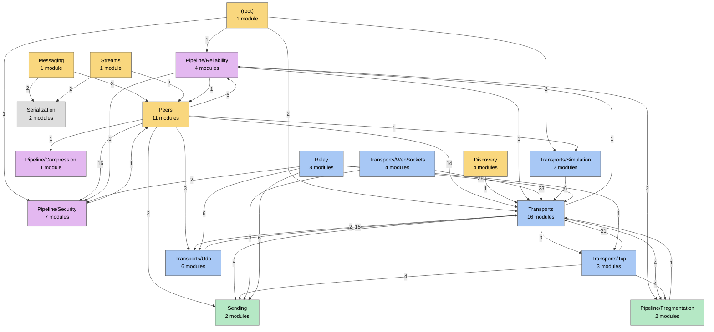

# Dependency overview

> [!NOTE]
> Generated by `tools/generate-vault.py` from the source — do not edit by hand; rerun the script after code changes.

Folders of `src/NetSync` (≈ namespaces) and how many module-to-module references cross between them. Arrows point from the user to what it uses. Layers run top to bottom; an arrow pointing *up* is a dependency against the layering — worth a look when it appears.

Colour = layer: API, Session, Transports, Infrastructure, Foundation (top to bottom). References to the utility folders and to `(root)` — `NetConfig.cs`, which also declares the `TransportType` enum nearly everything names — are left out of the drawing:

| Folder | Used by folders (references) |
|---|---|
| (root) | Peers (9), Pipeline/Reliability (1), Pipeline/Security (1), Transports (1), Pipeline/Fragmentation (1) |
| Diagnostics | (root) (1), Peers (6), Discovery (2), Pipeline/Reliability (1), Pipeline/Compression (1), Transports (4), Transports/Tcp (3), Transports/Udp (4), Transports/WebSockets (3), Relay (7), Sending (1), Internal (1) |
| Internal | Peers (8), Pipeline/Reliability (3), Pipeline/Security (1), Pipeline/Compression (1), Transports (6), Transports/Tcp (4), Transports/Udp (7), Transports/WebSockets (1), Transports/Simulation (1), Relay (6), Sending (3), Pipeline/Fragmentation (2) |

## Dependencies against the layering

| From | To | References | Modules |
|---|---|---|---|
| Pipeline/Fragmentation | (root) | 1 | [FragmentBuffer](../Code/Pipeline/Fragmentation/FragmentBuffer.md) → [NetConfig](../Code/Root/NetConfig.md) |
| Pipeline/Fragmentation | Transports | 1 | [PacketFragmenter](../Code/Pipeline/Fragmentation/PacketFragmenter.md) → [PacketProtocol](../Code/Transports/PacketProtocol.md) (`PacketType`) |
| Pipeline/Reliability | (root) | 1 | [ReliableEndpoint](../Code/Pipeline/Reliability/ReliableEndpoint.md) → [NetConfig](../Code/Root/NetConfig.md) (`ChannelConfig`, `NetConfig`, `TransportType`) |
| Pipeline/Reliability | Peers | 1 | [ReliableEndpoint](../Code/Pipeline/Reliability/ReliableEndpoint.md) → [PeerProtocol](../Code/Peers/PeerProtocol.md) |
| Pipeline/Security | (root) | 1 | [ConnectionCrypto](../Code/Pipeline/Security/ConnectionCrypto.md) → [NetConfig](../Code/Root/NetConfig.md) (`TransportType`) |
| Pipeline/Security | Peers | 1 | [LinkSecurity](../Code/Pipeline/Security/LinkSecurity.md) → [PeerProtocol](../Code/Peers/PeerProtocol.md) |
| Relay | Pipeline/Security | 2 | [NetRelayServer](../Code/Relay/NetRelayServer.md) → [ConnectionCrypto](../Code/Pipeline/Security/ConnectionCrypto.md) [RelayDatagramTransports](../Code/Relay/RelayDatagramTransports.md) → [ConnectionCrypto](../Code/Pipeline/Security/ConnectionCrypto.md) |
| Transports | (root) | 1 | [TransportSettings](../Code/Transports/TransportSettings.md) → [NetConfig](../Code/Root/NetConfig.md) |
| Transports | Pipeline/Reliability | 1 | [IPrioritizedTransport](../Code/Transports/IPrioritizedTransport.md) → [ReliabilityMode](../Code/Pipeline/Reliability/ReliabilityMode.md) (`ChannelPriority`) |

## Matrix

Module-to-module references from the row folder to the column folder (`T/` = Transports, `P/` = Pipeline). Above the diagonal = towards lower layers.

| from ↓ to → | (root) | Peers | Messaging | Streams | Discovery | P/Reliability | P/Security | P/Compression | Transports | T/Tcp | T/Udp | T/WebSockets | T/Simulation | Relay | Sending | P/Fragmentation | Serialization | Diagnostics | Internal |
|---|---|---|---|---|---|---|---|---|---|---|---|---|---|---|---|---|---|---|---|
| **(root)** | · |  |  |  |  | 1 | 1 |  | 2 |  |  |  | 2 |  |  |  |  | 1 |  |
| **Peers** | 9 | · |  |  |  | 6 | 16 | 1 | 14 |  | 3 |  | 1 |  | 2 |  |  | 6 | 8 |
| **Messaging** |  | 3 | · |  |  |  |  |  |  |  |  |  |  |  |  |  | 2 |  |  |
| **Streams** |  | 2 |  | · |  |  |  |  |  |  |  |  |  |  |  |  | 2 |  |  |
| **Discovery** |  |  |  |  | · |  |  |  | 1 |  |  |  |  |  |  |  |  | 2 |  |
| **P/Reliability** | 1 | 1 |  |  |  | · | 1 |  | 1 |  |  |  |  |  |  | 2 |  | 1 | 3 |
| **P/Security** | 1 | 1 |  |  |  |  | · |  |  |  |  |  |  |  |  |  |  |  | 1 |
| **P/Compression** |  |  |  |  |  |  |  | · |  |  |  |  |  |  |  |  |  | 1 | 1 |
| **Transports** | 1 |  |  |  |  | 1 |  |  | · | 3 | 2 |  |  |  | 5 | 4 |  | 4 | 6 |
| **T/Tcp** |  |  |  |  |  |  |  |  | 21 | · |  |  |  |  | 4 | 4 |  | 3 | 4 |
| **T/Udp** |  |  |  |  |  |  |  |  | 15 |  | · |  |  |  |  |  |  | 4 | 7 |
| **T/WebSockets** |  |  |  |  |  |  |  |  | 23 |  |  | · |  |  | 3 |  |  | 3 | 1 |
| **T/Simulation** |  |  |  |  |  |  |  |  | 6 |  |  |  | · |  |  |  |  |  | 1 |
| **Relay** |  |  |  |  |  |  | 2 |  | 28 | 1 | 6 |  |  | · | 6 |  |  | 7 | 6 |
| **Sending** |  |  |  |  |  |  |  |  |  |  |  |  |  |  | · |  |  | 1 | 3 |
| **P/Fragmentation** | 1 |  |  |  |  |  |  |  | 1 |  |  |  |  |  |  | · |  |  | 2 |
| **Serialization** |  |  |  |  |  |  |  |  |  |  |  |  |  |  |  |  | · |  |  |
| **Diagnostics** |  |  |  |  |  |  |  |  |  |  |  |  |  |  |  |  |  | · |  |
| **Internal** |  |  |  |  |  |  |  |  |  |  |  |  |  |  |  |  |  | 1 | · |

## Folders

| Folder | Layer | Modules |
|---|---|---|
| [(root)](Modules/Module%20map%20root.md) | API | [NetConfig](../Code/Root/NetConfig.md) |
| [Peers](Modules/Module%20map%20Peers.md) | API | [ChannelTransform](../Code/Peers/ChannelTransform.md), [ClockSync](../Code/Peers/ClockSync.md), [ConnectionApproval](../Code/Peers/ConnectionApproval.md), [EventDispatcher](../Code/Peers/EventDispatcher.md), [NetClient](../Code/Peers/NetClient.md), [NetConnection](../Code/Peers/NetConnection.md), [NetDataHandlers](../Code/Peers/NetDataHandlers.md), [NetListener](../Code/Peers/NetListener.md), [NetServer](../Code/Peers/NetServer.md), [PeerProtocol](../Code/Peers/PeerProtocol.md), [UdpHandover](../Code/Peers/UdpHandover.md) |
| [Messaging](Modules/Module%20map%20Messaging.md) | API | [NetMessages](../Code/Messaging/NetMessages.md) |
| [Streams](Modules/Module%20map%20Streams.md) | API | [NetStreams](../Code/Streams/NetStreams.md) |
| [Discovery](Modules/Module%20map%20Discovery.md) | API | [DiscoveryMessage](../Code/Discovery/DiscoveryMessage.md), [LanServerBroadcaster](../Code/Discovery/LanServerBroadcaster.md), [LanServerListener](../Code/Discovery/LanServerListener.md), [NetQuery](../Code/Discovery/NetQuery.md) |
| [Pipeline/Reliability](Modules/Module%20map%20Pipeline%20Reliability.md) | Session | [CongestionControl](../Code/Pipeline/Reliability/CongestionControl.md), [ReliabilityClock](../Code/Pipeline/Reliability/ReliabilityClock.md), [ReliabilityMode](../Code/Pipeline/Reliability/ReliabilityMode.md), [ReliableEndpoint](../Code/Pipeline/Reliability/ReliableEndpoint.md) |
| [Pipeline/Security](Modules/Module%20map%20Pipeline%20Security.md) | Session | [CipherSuite](../Code/Pipeline/Security/CipherSuite.md), [ConnectionCrypto](../Code/Pipeline/Security/ConnectionCrypto.md), [HandshakeKeys](../Code/Pipeline/Security/HandshakeKeys.md), [Hkdf](../Code/Pipeline/Security/Hkdf.md), [LinkSecurity](../Code/Pipeline/Security/LinkSecurity.md), [NetIdentity](../Code/Pipeline/Security/NetIdentity.md), [X25519](../Code/Pipeline/Security/X25519.md) |
| [Pipeline/Compression](Modules/Module%20map%20Pipeline%20Compression.md) | Session | [Compressor](../Code/Pipeline/Compression/Compressor.md) |
| [Transports](Modules/Module%20map%20Transports.md) | Transports | [BulkSender](../Code/Transports/BulkSender.md), [DisconnectReason](../Code/Transports/DisconnectReason.md), [DualStack](../Code/Transports/DualStack.md), [IPrioritizedTransport](../Code/Transports/IPrioritizedTransport.md), [IServerTransport](../Code/Transports/IServerTransport.md), [ITransport](../Code/Transports/ITransport.md), [ITransportFactory](../Code/Transports/ITransportFactory.md), [MessageLink](../Code/Transports/MessageLink.md), [PacketProtocol](../Code/Transports/PacketProtocol.md), [ReceiveBuffer](../Code/Transports/ReceiveBuffer.md), [SilenceTracker](../Code/Transports/SilenceTracker.md), [TcpAcceptLoop](../Code/Transports/TcpAcceptLoop.md), [TcpConnect](../Code/Transports/TcpConnect.md), [TransportCapabilities](../Code/Transports/TransportCapabilities.md), [TransportPeer](../Code/Transports/TransportPeer.md), [TransportSettings](../Code/Transports/TransportSettings.md) |
| [Transports/Tcp](Modules/Module%20map%20Transports%20Tcp.md) | Transports | [TcpFrameReader](../Code/Transports/Tcp/TcpFrameReader.md), [TcpServerTransport](../Code/Transports/Tcp/TcpServerTransport.md), [TcpTransport](../Code/Transports/Tcp/TcpTransport.md) |
| [Transports/Udp](Modules/Module%20map%20Transports%20Udp.md) | Transports | [DatagramBatcher](../Code/Transports/Udp/DatagramBatcher.md), [EndPointCache](../Code/Transports/Udp/EndPointCache.md), [PathMtuProbe](../Code/Transports/Udp/PathMtuProbe.md), [UdpServerTransport](../Code/Transports/Udp/UdpServerTransport.md), [UdpSockets](../Code/Transports/Udp/UdpSockets.md), [UdpTransport](../Code/Transports/Udp/UdpTransport.md) |
| [Transports/WebSockets](Modules/Module%20map%20Transports%20WebSockets.md) | Transports | [WebSocketClientTransport](../Code/Transports/WebSockets/WebSocketClientTransport.md), [WebSocketHandshake](../Code/Transports/WebSockets/WebSocketHandshake.md), [WebSocketServerTransport](../Code/Transports/WebSockets/WebSocketServerTransport.md), [WebSocketTransportFactory](../Code/Transports/WebSockets/WebSocketTransportFactory.md) |
| [Transports/Simulation](Modules/Module%20map%20Transports%20Simulation.md) | Transports | [NetworkSimulation](../Code/Transports/Simulation/NetworkSimulation.md), [SimulatedTransportFactory](../Code/Transports/Simulation/SimulatedTransportFactory.md) |
| [Relay](Modules/Module%20map%20Relay.md) | Transports | [DatagramSocket](../Code/Relay/DatagramSocket.md), [FramedConnection](../Code/Relay/FramedConnection.md), [NetRelayServer](../Code/Relay/NetRelayServer.md), [RelayDatagramTransports](../Code/Relay/RelayDatagramTransports.md), [RelayHostSession](../Code/Relay/RelayHostSession.md), [RelayProtocol](../Code/Relay/RelayProtocol.md), [RelayRoom](../Code/Relay/RelayRoom.md), [RelayStreamTransports](../Code/Relay/RelayStreamTransports.md) |
| [Sending](Modules/Module%20map%20Sending.md) | Infrastructure | [SendPriority](../Code/Sending/SendPriority.md), [SendQueue](../Code/Sending/SendQueue.md) |
| [Pipeline/Fragmentation](Modules/Module%20map%20Pipeline%20Fragmentation.md) | Infrastructure | [FragmentBuffer](../Code/Pipeline/Fragmentation/FragmentBuffer.md), [PacketFragmenter](../Code/Pipeline/Fragmentation/PacketFragmenter.md) |
| [Serialization](Modules/Module%20map%20Serialization.md) | Foundation | [NetReader](../Code/Serialization/NetReader.md), [NetWriter](../Code/Serialization/NetWriter.md) |
| [Diagnostics](Modules/Module%20map%20Diagnostics.md) | Foundation | [INetLogger](../Code/Diagnostics/INetLogger.md), [NetMetrics](../Code/Diagnostics/NetMetrics.md), [NetStatistics](../Code/Diagnostics/NetStatistics.md) |
| [Internal](Modules/Module%20map%20Internal.md) | Foundation | [AsyncSignal](../Code/Internal/AsyncSignal.md), [NetTime](../Code/Internal/NetTime.md), [Pooled](../Code/Internal/Pooled.md), [TaskExtensions](../Code/Internal/TaskExtensions.md) |
