# Module map Diagnostics

> [!info] Generated by `tools/generate-vault.py` from the source — do not edit by hand; rerun the script after code changes.

Modules in `src/NetSync/Diagnostics/`, their dependencies on each other, and the other folders they use or are used by.

```mermaid
flowchart LR
  subgraph f_Diagnostics["Diagnostics"]
    m_INetLogger["INetLogger"]:::foundation
    m_NetMetrics["NetMetrics"]:::foundation
    m_NetStatistics["NetStatistics"]:::foundation
  end
  m_NetConfig["NetConfig<br/><small>(root)</small>"]:::api
  m_ChannelTransform["ChannelTransform<br/><small>Peers</small>"]:::api
  m_EventDispatcher["EventDispatcher<br/><small>Peers</small>"]:::api
  m_NetClient["NetClient<br/><small>Peers</small>"]:::api
  m_NetConnection["NetConnection<br/><small>Peers</small>"]:::api
  m_NetServer["NetServer<br/><small>Peers</small>"]:::api
  m_LanServerBroadcaster["LanServerBroadcaster<br/><small>Discovery</small>"]:::api
  m_LanServerListener["LanServerListener<br/><small>Discovery</small>"]:::api
  m_ReliableEndpoint["ReliableEndpoint<br/><small>Pipeline/Reliability</small>"]:::session
  m_Compressor["Compressor<br/><small>Pipeline/Compression</small>"]:::session
  m_BulkSender["BulkSender<br/><small>Transports</small>"]:::transports
  m_MessageLink["MessageLink<br/><small>Transports</small>"]:::transports
  m_TcpAcceptLoop["TcpAcceptLoop<br/><small>Transports</small>"]:::transports
  m_TransportSettings["TransportSettings<br/><small>Transports</small>"]:::transports
  m_TcpServerTransport["TcpServerTransport<br/><small>Transports/Tcp</small>"]:::transports
  m_TcpTransport["TcpTransport<br/><small>Transports/Tcp</small>"]:::transports
  m_DatagramBatcher["DatagramBatcher<br/><small>Transports/Udp</small>"]:::transports
  m_UdpServerTransport["UdpServerTransport<br/><small>Transports/Udp</small>"]:::transports
  m_UdpTransport["UdpTransport<br/><small>Transports/Udp</small>"]:::transports
  m_WebSocketClientTransport["WebSocketClientTransport<br/><small>Transports/WebSockets</small>"]:::transports
  m_WebSocketServerTransport["WebSocketServerTransport<br/><small>Transports/WebSockets</small>"]:::transports
  m_FramedConnection["FramedConnection<br/><small>Relay</small>"]:::transports
  m_NetRelayServer["NetRelayServer<br/><small>Relay</small>"]:::transports
  m_RelayDatagramTransports["RelayDatagramTransports<br/><small>Relay</small>"]:::transports
  m_RelayHostSession["RelayHostSession<br/><small>Relay</small>"]:::transports
  m_RelayRoom["RelayRoom<br/><small>Relay</small>"]:::transports
  m_RelayStreamTransports["RelayStreamTransports<br/><small>Relay</small>"]:::transports
  m_SendQueue["SendQueue<br/><small>Sending</small>"]:::infrastructure
  m_TaskExtensions["TaskExtensions<br/><small>Internal</small>"]:::foundation
  m_ChannelTransform -.-> m_INetLogger
  m_Compressor -.-> m_INetLogger
  m_DatagramBatcher -.-> m_INetLogger
  m_EventDispatcher -.-> m_INetLogger
  m_FramedConnection -.-> m_INetLogger
  m_LanServerBroadcaster -.-> m_INetLogger
  m_LanServerListener -.-> m_INetLogger
  m_NetClient -.-> m_INetLogger
  m_NetConfig -.-> m_INetLogger
  m_NetRelayServer -.-> m_INetLogger
  m_NetServer -.-> m_INetLogger
  m_RelayDatagramTransports -.-> m_INetLogger
  m_RelayHostSession -.-> m_INetLogger
  m_RelayRoom -.-> m_INetLogger
  m_RelayStreamTransports -.-> m_INetLogger
  m_ReliableEndpoint -.-> m_INetLogger
  m_SendQueue -.-> m_INetLogger
  m_TaskExtensions -.-> m_INetLogger
  m_TcpAcceptLoop -.-> m_INetLogger
  m_TcpServerTransport -.-> m_INetLogger
  m_TcpTransport -.-> m_INetLogger
  m_TransportSettings -.-> m_INetLogger
  m_UdpServerTransport -.-> m_INetLogger
  m_UdpTransport -.-> m_INetLogger
  m_WebSocketClientTransport -.-> m_INetLogger
  m_WebSocketServerTransport -.-> m_INetLogger
  m_BulkSender -.-> m_NetMetrics
  m_MessageLink -.-> m_NetMetrics
  m_RelayDatagramTransports -.-> m_NetMetrics
  m_TcpTransport -.-> m_NetMetrics
  m_UdpTransport -.-> m_NetMetrics
  m_WebSocketClientTransport -.-> m_NetMetrics
  m_NetClient -.-> m_NetStatistics
  m_NetConnection -.-> m_NetStatistics
  classDef api fill:#f9d77e,stroke:#555,color:#000
  classDef session fill:#e3b8f0,stroke:#555,color:#000
  classDef transports fill:#a8c8f5,stroke:#555,color:#000
  classDef infrastructure fill:#b5e8c5,stroke:#555,color:#000
  classDef foundation fill:#dddddd,stroke:#555,color:#000
```

Solid arrows stay inside the folder; dotted ones cross its boundary (outside modules are coloured by layer).

| Module | Summary | Uses | Used by |
|---|---|---|---|
| [[INetLogger]] | Logging abstraction so the core stays platform-agnostic. Implementations must be thread-safe: transports log from background threads. | 0 | 26 |
| [[NetMetrics]] | Per-connection counters. All writes go through `Interlocked` so the metrics can be read from any thread while network threads update them. | 0 | 6 |
| [[NetStatistics]] | Point-in-time snapshot of a connection's traffic, as seen by the application: message counts and payload bytes (before compression/encryption), plus the… | 0 | 2 |
