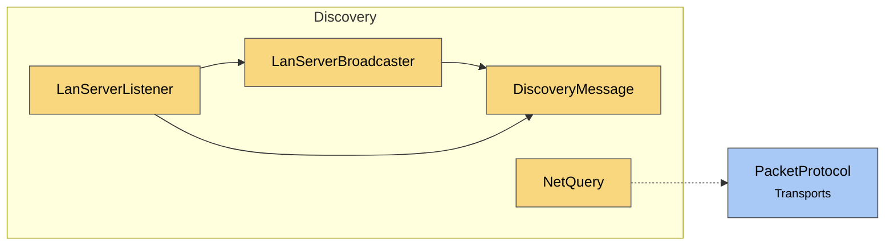

# Module map Discovery

> [!info] Generated by `tools/generate-vault.py` from the source — do not edit by hand; rerun the script after code changes.

Modules in `src/NetSync/Discovery/`, their dependencies on each other, and the other folders they use or are used by.

Solid arrows stay inside the folder; dotted ones cross its boundary (outside modules are coloured by layer). Also uses the utilities [[INetLogger]].

| Module | Summary | Uses | Used by |
|---|---|---|---|
| [[DiscoveryMessage]] | LAN discovery datagram: v2 [magic "NSD2":4][serverPort:2 BE][appIdLen:1][appId utf8][payloadLen:2 BE][payload] v1 [magic "NSD1":4][serverPort:2… | 0 | 2 |
| [[LanServerBroadcaster]] | Announces a server on the local network: periodically broadcasts a discovery datagram on every IPv4 LAN interface (Ethernet/Wi-Fi). The Unity-free… | 2 | 1 |
| [[LanServerListener]] | Listens for `LanServerBroadcaster` announcements and raises `ServerFound` with the server's connectable endpoint. The event fires on a background thread and… | 3 | 0 |
| [[NetQuery]] | Connectionless request/response with a NetSync server's UDP port: ask a server for its name, map, player count… without connecting. The server answers… | 1 | 0 |
