# Module map Internal

> [!info] Generated by `tools/generate-vault.py` from the source — do not edit by hand; rerun the script after code changes.

Modules in `src/NetSync/Internal/`, their dependencies on each other, and the other folders they use or are used by.

```mermaid
flowchart LR
  subgraph f_Internal["Internal"]
    m_AsyncSignal["AsyncSignal"]:::foundation
    m_NetTime["NetTime"]:::foundation
    m_Pooled["Pooled"]:::foundation
    m_TaskExtensions["TaskExtensions"]:::foundation
  end
  m_ChannelTransform["ChannelTransform<br/><small>Peers</small>"]:::api
  m_EventDispatcher["EventDispatcher<br/><small>Peers</small>"]:::api
  m_NetClient["NetClient<br/><small>Peers</small>"]:::api
  m_NetServer["NetServer<br/><small>Peers</small>"]:::api
  m_ReliabilityClock["ReliabilityClock<br/><small>Pipeline/Reliability</small>"]:::session
  m_ReliableEndpoint["ReliableEndpoint<br/><small>Pipeline/Reliability</small>"]:::session
  m_LinkSecurity["LinkSecurity<br/><small>Pipeline/Security</small>"]:::session
  m_Compressor["Compressor<br/><small>Pipeline/Compression</small>"]:::session
  m_BulkSender["BulkSender<br/><small>Transports</small>"]:::transports
  m_MessageLink["MessageLink<br/><small>Transports</small>"]:::transports
  m_ReceiveBuffer["ReceiveBuffer<br/><small>Transports</small>"]:::transports
  m_TransportCapabilities["TransportCapabilities<br/><small>Transports</small>"]:::transports
  m_TransportPeer["TransportPeer<br/><small>Transports</small>"]:::transports
  m_TcpServerTransport["TcpServerTransport<br/><small>Transports/Tcp</small>"]:::transports
  m_TcpTransport["TcpTransport<br/><small>Transports/Tcp</small>"]:::transports
  m_DatagramBatcher["DatagramBatcher<br/><small>Transports/Udp</small>"]:::transports
  m_UdpServerTransport["UdpServerTransport<br/><small>Transports/Udp</small>"]:::transports
  m_UdpTransport["UdpTransport<br/><small>Transports/Udp</small>"]:::transports
  m_WebSocketServerTransport["WebSocketServerTransport<br/><small>Transports/WebSockets</small>"]:::transports
  m_SimulatedTransportFactory["SimulatedTransportFactory<br/><small>Transports/Simulation</small>"]:::transports
  m_FramedConnection["FramedConnection<br/><small>Relay</small>"]:::transports
  m_NetRelayServer["NetRelayServer<br/><small>Relay</small>"]:::transports
  m_RelayDatagramTransports["RelayDatagramTransports<br/><small>Relay</small>"]:::transports
  m_RelayStreamTransports["RelayStreamTransports<br/><small>Relay</small>"]:::transports
  m_SendQueue["SendQueue<br/><small>Sending</small>"]:::infrastructure
  m_FragmentBuffer["FragmentBuffer<br/><small>Pipeline/Fragmentation</small>"]:::infrastructure
  m_INetLogger["INetLogger<br/><small>Diagnostics</small>"]:::foundation
  m_DatagramBatcher -.-> m_AsyncSignal
  m_SendQueue -.-> m_AsyncSignal
  m_FragmentBuffer -.-> m_NetTime
  m_FramedConnection -.-> m_NetTime
  m_MessageLink -.-> m_NetTime
  m_NetClient -.-> m_NetTime
  m_NetRelayServer -.-> m_NetTime
  m_NetServer -.-> m_NetTime
  m_RelayDatagramTransports -.-> m_NetTime
  m_RelayStreamTransports -.-> m_NetTime
  m_ReliabilityClock -.-> m_NetTime
  m_ReliableEndpoint -.-> m_NetTime
  m_SendQueue -.-> m_NetTime
  m_SimulatedTransportFactory -.-> m_NetTime
  m_TcpServerTransport -.-> m_NetTime
  m_TcpTransport -.-> m_NetTime
  m_TransportPeer -.-> m_NetTime
  m_UdpServerTransport -.-> m_NetTime
  m_UdpTransport -.-> m_NetTime
  m_WebSocketServerTransport -.-> m_NetTime
  m_BulkSender -.-> m_Pooled
  m_ChannelTransform -.-> m_Pooled
  m_Compressor -.-> m_Pooled
  m_DatagramBatcher -.-> m_Pooled
  m_EventDispatcher -.-> m_Pooled
  m_FragmentBuffer -.-> m_Pooled
  m_FramedConnection -.-> m_Pooled
  m_LinkSecurity -.-> m_Pooled
  m_MessageLink -.-> m_Pooled
  m_NetClient -.-> m_Pooled
  m_NetServer -.-> m_Pooled
  m_ReceiveBuffer -.-> m_Pooled
  m_RelayDatagramTransports -.-> m_Pooled
  m_ReliableEndpoint -.-> m_Pooled
  m_SendQueue -.-> m_Pooled
  m_TcpServerTransport -.-> m_Pooled
  m_TcpTransport -.-> m_Pooled
  m_TransportCapabilities -.-> m_Pooled
  m_UdpServerTransport -.-> m_Pooled
  m_UdpTransport -.-> m_Pooled
  m_TaskExtensions -.-> m_INetLogger
  classDef api fill:#f9d77e,stroke:#555,color:#000
  classDef session fill:#e3b8f0,stroke:#555,color:#000
  classDef transports fill:#a8c8f5,stroke:#555,color:#000
  classDef infrastructure fill:#b5e8c5,stroke:#555,color:#000
  classDef foundation fill:#dddddd,stroke:#555,color:#000
```

Solid arrows stay inside the folder; dotted ones cross its boundary (outside modules are coloured by layer).

| Module | Summary | Uses | Used by |
|---|---|---|---|
| [[AsyncSignal]] | Allocation-free auto-reset signal for exactly one async waiter. A Set() that arrives while nobody waits is remembered (one pending wake-up); a Set() during… | 0 | 2 |
| [[NetTime]] | Monotonic clock. DateTime.UtcNow is not monotonic (NTP jumps, DST issues on some platforms) and must not be used for RTT or timeout measurement. | 0 | 18 |
| [[Pooled]] | The one buffer pool of the library. Rented arrays are usually longer than asked for — always carry the length alongside, never use array.Length. | 0 | 20 |
| [[TaskExtensions]] | Fire-and-forget helpers that never leave a failure unobserved. | 1 | 0 |
