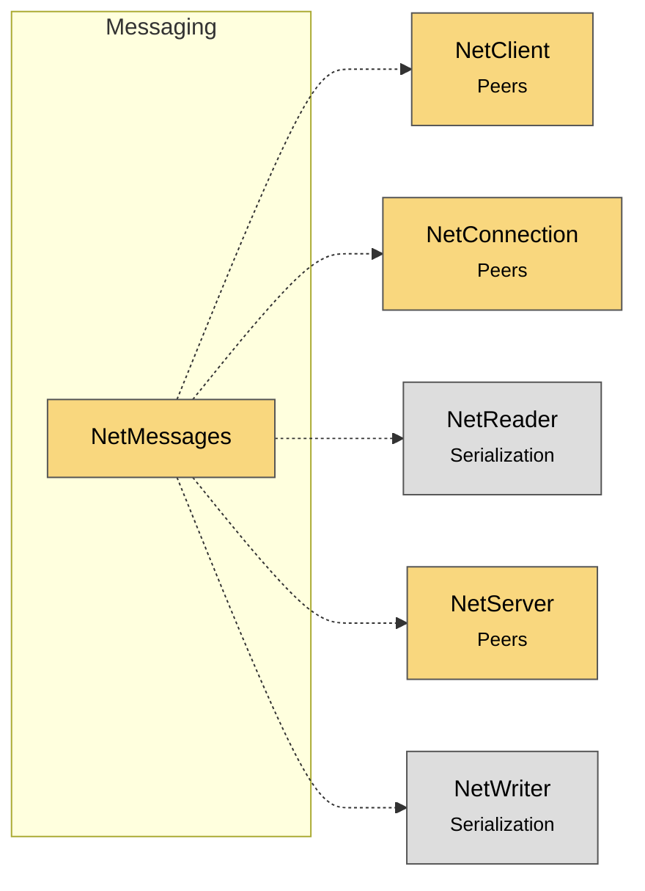

# Module map Messaging

> [!info] Generated by `tools/generate-vault.py` from the source — do not edit by hand; rerun the script after code changes.

Modules in `src/NetSync/Messaging/`, their dependencies on each other, and the other folders they use or are used by.

Solid arrows stay inside the folder; dotted ones cross its boundary (outside modules are coloured by layer).

| Module | Summary | Uses | Used by |
|---|---|---|---|
| [[NetMessages]] | A message type: knows how to write itself to and read itself from the binary stream. Classes or structs; no reflection involved, IL2CPP/AOT safe. Struct… | 5 | 0 |
