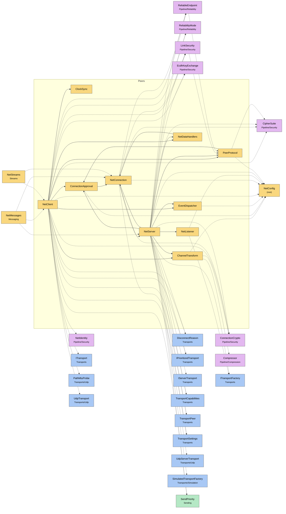

# Module map Peers

> [!info] Generated by `tools/generate-vault.py` from the source — do not edit by hand; rerun the script after code changes.

Modules in `src/NetSync/Peers/`, their dependencies on each other, and the other folders they use or are used by.

Solid arrows stay inside the folder; dotted ones cross its boundary (outside modules are coloured by layer). Also uses the utilities [[INetLogger]], [[NetStatistics]], [[NetTime]], [[Pooled]].

| Module | Summary | Uses | Used by |
|---|---|---|---|
| [[ChannelTransform]] | Per-channel payload pipeline: compress, then encrypt (compressing ciphertext is pointless). Runs before reliability/fragmentation, which treat the result as… | 5 | 2 |
| [[ClockSync]] | Estimates the offset between this client's clock and the server's, NTP-style: each round trip gives offset = serverTime + rtt/2 − localReceiveTime, which is… | 0 | 1 |
| [[ConnectionApproval]] | A client asking to join (see `ConnectionApprover`). The handshake is complete — keys established, server identity proven — but the connection isn't open… | 2 | 3 |
| [[EventDispatcher]] | Routes events either straight through (Immediate) or into a queue drained by PollEvents (Polled). Handler exceptions are logged, never propagated into… | 3 | 2 |
| [[NetClient]] |  | 26 | 2 |
| [[NetConnection]] | A connected client as seen by `NetServer`: one logical connection spanning one transport link per configured transport type. | 8 | 5 |
| [[NetDataHandlers]] | Zero-copy data handler for `MessageReceived`. `data` points into a pooled buffer and is valid only until the handler returns: parse it, pass it to SendAsync… | 1 | 2 |
| [[NetListener]] | An extra transport a `NetServer` accepts clients on (see `AddListener`). | 2 | 1 |
| [[NetServer]] |  | 27 | 2 |
| [[PeerProtocol]] | Peer-level messages, carried inside transport Data payloads. Handshake (plaintext): Hello… | 3 | 4 |
