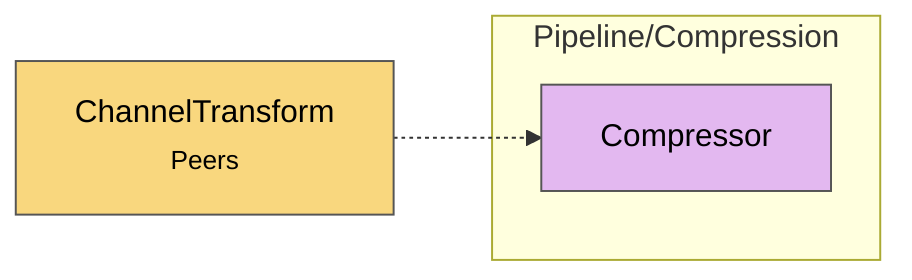

# Module map Pipeline Compression

> [!info] Generated by `tools/generate-vault.py` from the source — do not edit by hand; rerun the script after code changes.

Modules in `src/NetSync/Pipeline/Compression/`, their dependencies on each other, and the other folders they use or are used by.

Solid arrows stay inside the folder; dotted ones cross its boundary (outside modules are coloured by layer). Also uses the utilities [[INetLogger]], [[Pooled]].

| Module | Summary | Uses | Used by |
|---|---|---|---|
| [[Compressor]] | Deflate payload compression. Format: [originalLength:4 BE][deflate stream]. The explicit length lets the receiver allocate exactly once and enforce a… | 2 | 1 |
