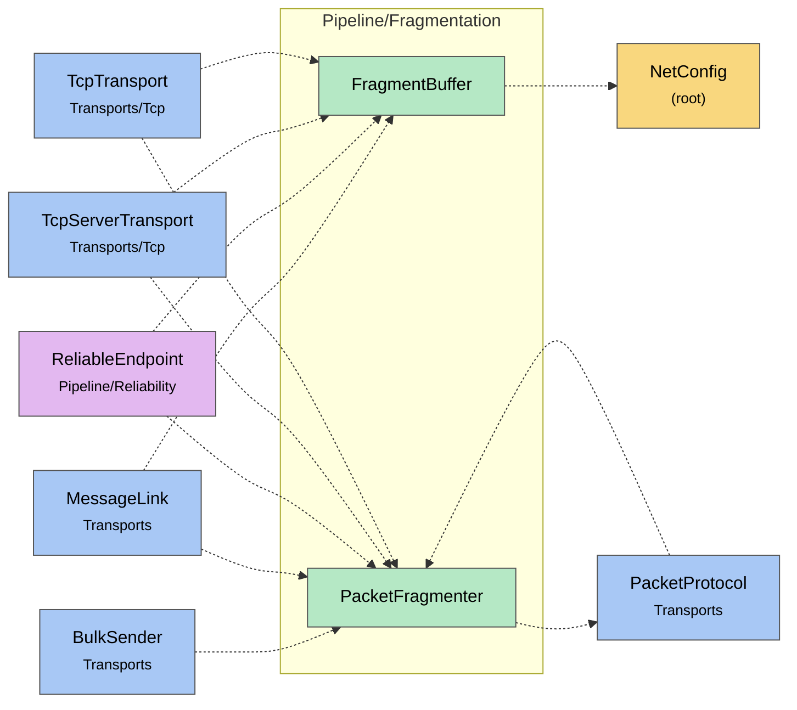

# Module map Pipeline Fragmentation

> [!info] Generated by `tools/generate-vault.py` from the source — do not edit by hand; rerun the script after code changes.

Modules in `src/NetSync/Pipeline/Fragmentation/`, their dependencies on each other, and the other folders they use or are used by.

Solid arrows stay inside the folder; dotted ones cross its boundary (outside modules are coloured by layer). Also uses the utilities [[NetTime]], [[Pooled]].

| Module | Summary | Uses | Used by |
|---|---|---|---|
| [[FragmentBuffer]] | Reassembles fragmented packets with hard memory bounds — the remote decides fragment counts and sizes, so every number it sends is treated as hostile:… | 3 | 4 |
| [[PacketFragmenter]] | Splits large payloads into fragments and back. Fragment wire format: [Fragment:1][seqId:4 BE][index:4 BE][total:4 BE][data] | 1 | 6 |
