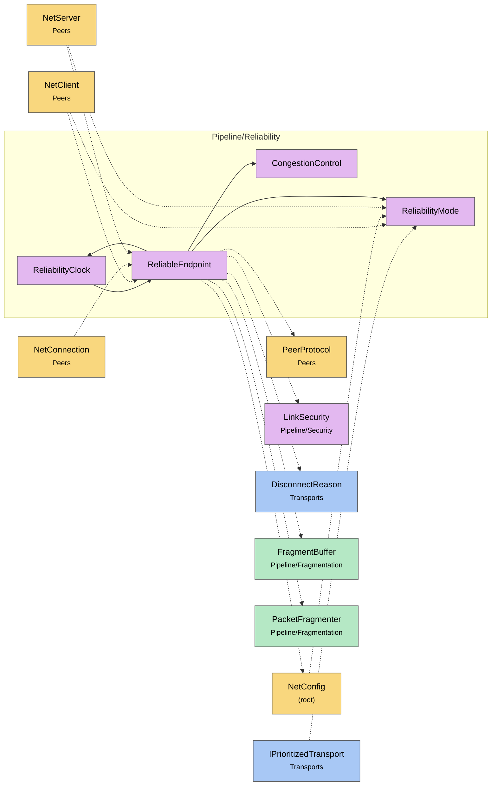

# Module map Pipeline Reliability

> [!info] Generated by `tools/generate-vault.py` from the source — do not edit by hand; rerun the script after code changes.

Modules in `src/NetSync/Pipeline/Reliability/`, their dependencies on each other, and the other folders they use or are used by.

Solid arrows stay inside the folder; dotted ones cross its boundary (outside modules are coloured by layer). Also uses the utilities [[INetLogger]], [[NetTime]], [[Pooled]].

| Module | Summary | Uses | Used by |
|---|---|---|---|
| [[CongestionControl]] | Link round-trip estimator from ACK samples (RFC 6298: SRTT/RTTVAR, Karn's rule is applied by the caller — only first transmissions are sampled). Also tracks… | 0 | 1 |
| [[ReliabilityClock]] | One thread drives the retransmission timers of every `ReliableEndpoint` in the process. A loop per endpoint would mean a timer wake-up per connection every… | 2 | 1 |
| [[ReliabilityMode]] | Delivery guarantees for a channel. Only meaningful on UDP: TCP channels are inherently reliable-ordered and ignore this setting. | 0 | 5 |
| [[ReliableEndpoint]] | Reliability engine for one unreliable datagram link (ENet-style ARQ with TCP-grade congestion control). One instance per datagram link; transport-agnostic —… | 12 | 4 |
