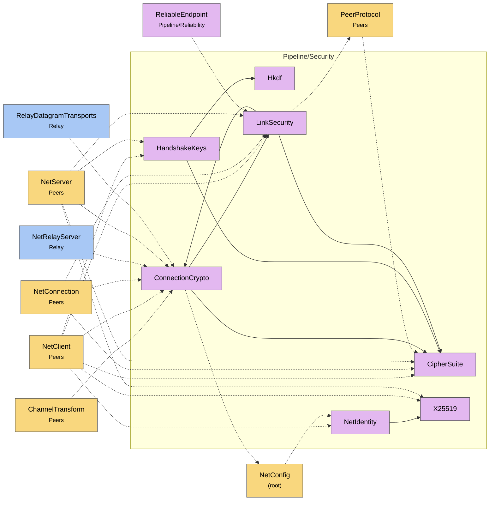

# Module map Pipeline Security

> [!NOTE]
> Generated by `tools/generate-vault.py` from the source — do not edit by hand; rerun the script after code changes.

Modules in `src/NetSync/Pipeline/Security/`, their dependencies on each other, and the other folders they use or are used by.

Solid arrows stay inside the folder; dotted ones cross its boundary (outside modules are coloured by layer). Also uses the utilities [Pooled](../../Code/Internal/Pooled.md).

| Module | Summary | Uses | Used by |
|---|---|---|---|
| [CipherSuite](../../Code/Pipeline/Security/CipherSuite.md) | How an encrypted connection protects packets. Negotiated in the handshake: the client offers what its runtime supports, the server picks the best common suite. | 0 | 7 |
| [ConnectionCrypto](../../Code/Pipeline/Security/ConnectionCrypto.md) | Per-connection key material and the payload cipher, for one side (client or server) of one connection. Every key is per direction (client→server,… | 3 | 7 |
| [HandshakeKeys](../../Code/Pipeline/Security/HandshakeKeys.md) | Session keys of protocol v4. Every keyed connection runs an ephemeral X25519 exchange, so both sides contribute fresh randomness to every session; what… | 2 | 2 |
| [Hkdf](../../Code/Pipeline/Security/Hkdf.md) | HKDF with HMAC-SHA256 (RFC 5869). The class library has one only on newer targets; this is the same function everywhere. | 0 | 1 |
| [LinkSecurity](../../Code/Pipeline/Security/LinkSecurity.md) | Authenticates every post-handshake packet on one link of an encrypted connection. Envelope: [MsgSecure:1][counter:8 BE][tag:16][inner peer message…] -… | 4 | 5 |
| [NetIdentity](../../Code/Pipeline/Security/NetIdentity.md) | A server's long-term identity: an X25519 key pair. Every handshake mixes an exchange with this key into the session keys, so only the holder of the private… | 1 | 2 |
| [X25519](../../Code/Pipeline/Security/X25519.md) |  | 0 | 3 |
