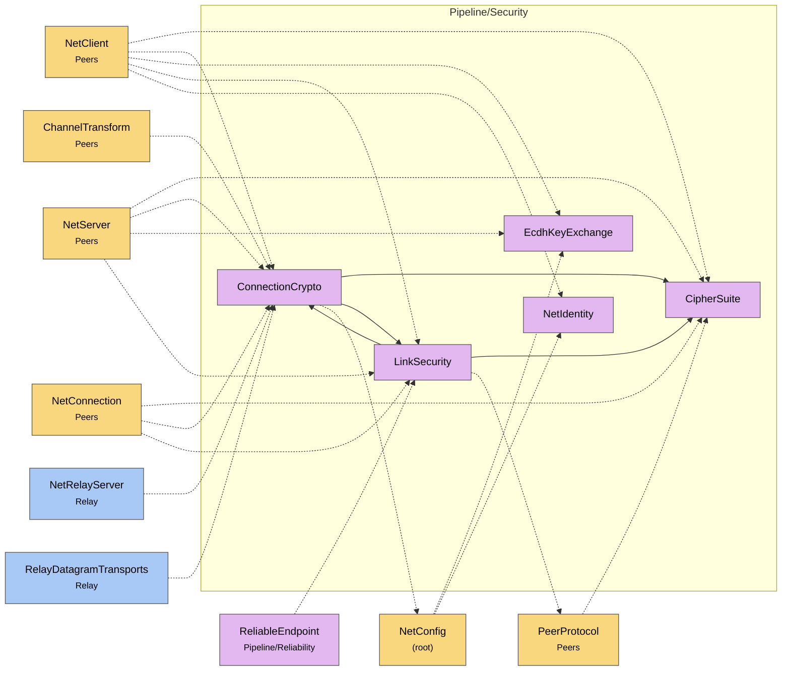

# Module map Pipeline Security

> [!info] Generated by `tools/generate-vault.py` from the source — do not edit by hand; rerun the script after code changes.

Modules in `src/NetSync/Pipeline/Security/`, their dependencies on each other, and the other folders they use or are used by.

Solid arrows stay inside the folder; dotted ones cross its boundary (outside modules are coloured by layer). Also uses the utilities [[Pooled]].

| Module | Summary | Uses | Used by |
|---|---|---|---|
| [[CipherSuite]] | How an encrypted connection protects packets. Negotiated in the handshake: the client offers what its runtime supports, the server picks the best common suite. | 0 | 6 |
| [[ConnectionCrypto]] | Per-connection key material and the payload cipher, for one side (client or server) of one connection. Every key is per direction (client→server,… | 3 | 7 |
| [[EcdhKeyExchange]] | Ephemeral ECDH (NIST P-256) helpers. Public keys travel as raw 64-byte X‖Y points — no ASN.1, works on both target frameworks. The exchange is… | 0 | 3 |
| [[LinkSecurity]] | Authenticates every post-handshake packet on one link of an encrypted connection. Envelope: [MsgSecure:1][counter:8 BE][tag:16][inner peer message…] -… | 4 | 5 |
| [[NetIdentity]] | A server's long-term identity: an ECDSA P-256 key pair. The server signs every ECDH handshake with it; clients that pin the public key (`TrustedServerKeys`)… | 0 | 2 |
