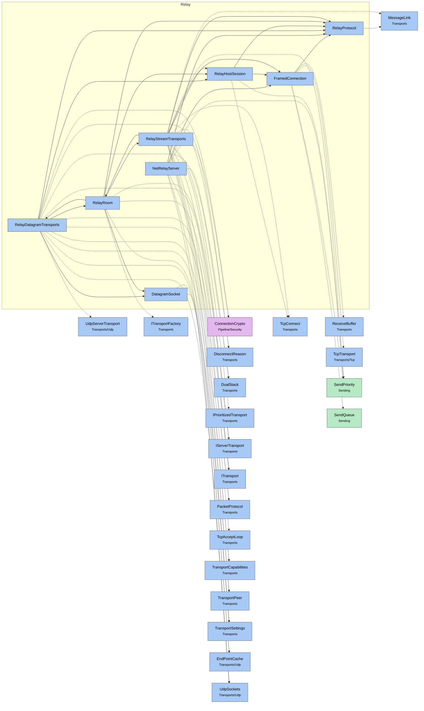

# Module map Relay

> [!info] Generated by `tools/generate-vault.py` from the source — do not edit by hand; rerun the script after code changes.

Modules in `src/NetSync/Relay/`, their dependencies on each other, and the other folders they use or are used by.

Solid arrows stay inside the folder; dotted ones cross its boundary (outside modules are coloured by layer). Also uses the utilities [[INetLogger]], [[NetMetrics]], [[NetTime]], [[Pooled]].

| Module | Summary | Uses | Used by |
|---|---|---|---|
| [[DatagramSocket]] | A plain unconnected UDP socket on an ephemeral port. On net8.0 sends and receives cost no allocation (cached addresses: a relay socket talks to a handful of… | 2 | 2 |
| [[FramedConnection]] | A TCP connection carrying relay frames ([kind][length][body]) in both directions: coalescing priority send queue, one pooled receive buffer, bounded frame… | 8 | 3 |
| [[NetRelayServer]] | Relay (and hole-punching rendezvous) for games and apps hosted behind NAT. A host claims a room; clients join it by the room code; the relay forwards their… | 10 | 0 |
| [[RelayDatagramTransports]] | Client datagram slot through a relay, with UDP hole punching. Registers with the relay (which answers with a client id and the host's public endpoint),… | 19 | 1 |
| [[RelayHostSession]] | A host's control connection to the relay: claims the room, receives the secret that authorizes the host's UDP registration, and multiplexes every stream… | 5 | 3 |
| [[RelayProtocol]] | Wire format between relay clients/hosts and `NetRelayServer`. The relay never looks inside the NetSync packets it carries ("message" below) — with a key… | 1 | 6 |
| [[RelayRoom]] | A room on a `NetRelayServer`: the way to reach a server behind NAT. Host — keep accepting LAN clients directly, add the relay as extra listeners: Client —… | 10 | 2 |
| [[RelayStreamTransports]] | Client stream slot through a relay: one TCP connection, NetSync packets as Data frames. | 17 | 1 |
