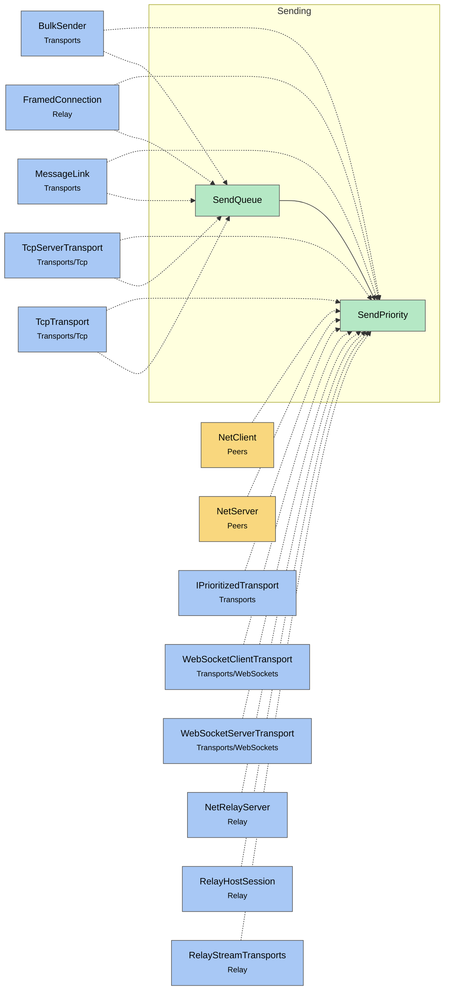

# Module map Sending

> [!info] Generated by `tools/generate-vault.py` from the source — do not edit by hand; rerun the script after code changes.

Modules in `src/NetSync/Sending/`, their dependencies on each other, and the other folders they use or are used by.

Solid arrows stay inside the folder; dotted ones cross its boundary (outside modules are coloured by layer). Also uses the utilities [[AsyncSignal]], [[INetLogger]], [[NetTime]], [[Pooled]].

| Module | Summary | Uses | Used by |
|---|---|---|---|
| [[SendPriority]] |  | 0 | 14 |
| [[SendQueue]] | Priority send queue with a dedicated drain loop. - Wakes exactly when work arrives, without allocating (`AsyncSignal`). After an idle period the first write… | 5 | 5 |
