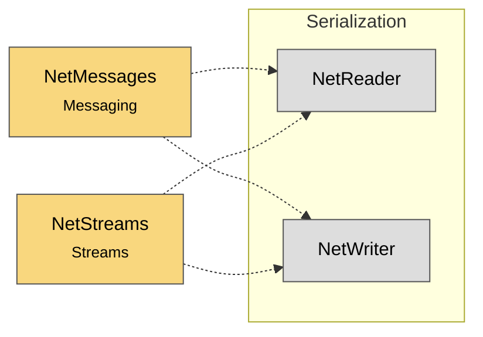

# Module map Serialization

> [!info] Generated by `tools/generate-vault.py` from the source — do not edit by hand; rerun the script after code changes.

Modules in `src/NetSync/Serialization/`, their dependencies on each other, and the other folders they use or are used by.

Solid arrows stay inside the folder; dotted ones cross its boundary (outside modules are coloured by layer).

| Module | Summary | Uses | Used by |
|---|---|---|---|
| [[NetReader]] | Counterpart of `NetWriter`: reads primitives from a received payload. Throws `EndOfStreamException` on malformed/truncated input — always wrap parsing of… | 0 | 2 |
| [[NetWriter]] | Compact binary writer for building message payloads — the replacement for the 1.x string-based JsonMessage. Little-endian fixed-width primitives, LEB128… | 0 | 2 |
