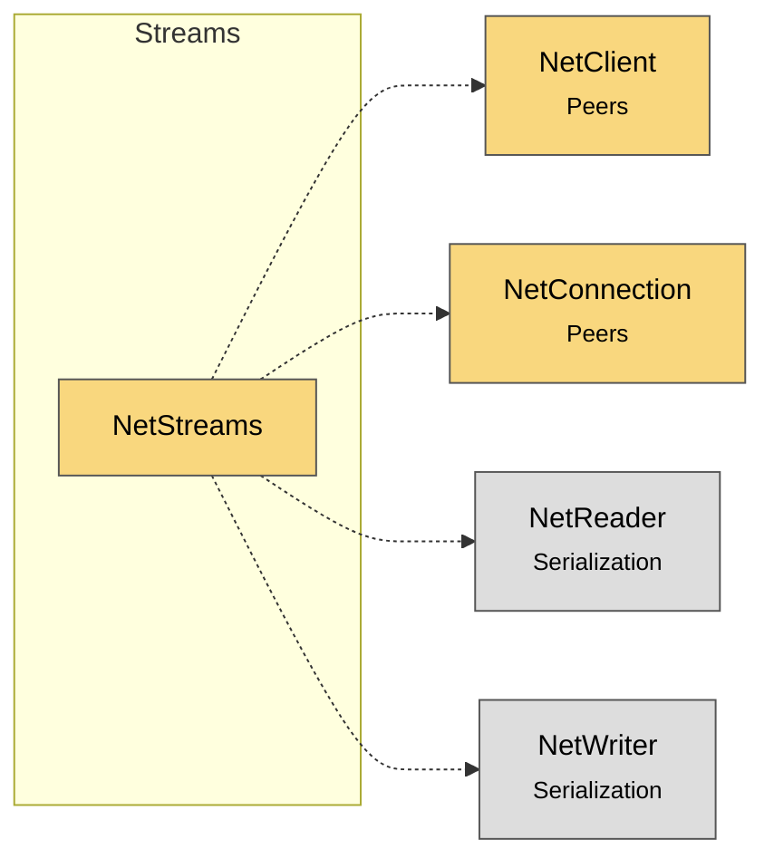

# Module map Streams

> [!info] Generated by `tools/generate-vault.py` from the source — do not edit by hand; rerun the script after code changes.

Modules in `src/NetSync/Streams/`, their dependencies on each other, and the other folders they use or are used by.

Solid arrows stay inside the folder; dotted ones cross its boundary (outside modules are coloured by layer).

| Module | Summary | Uses | Used by |
|---|---|---|---|
| [[NetStreams]] | Sends arbitrarily large data (files, recordings) as a sequence of chunk messages, with memory bounded by the transport's backpressure — never the whole… | 4 | 0 |
