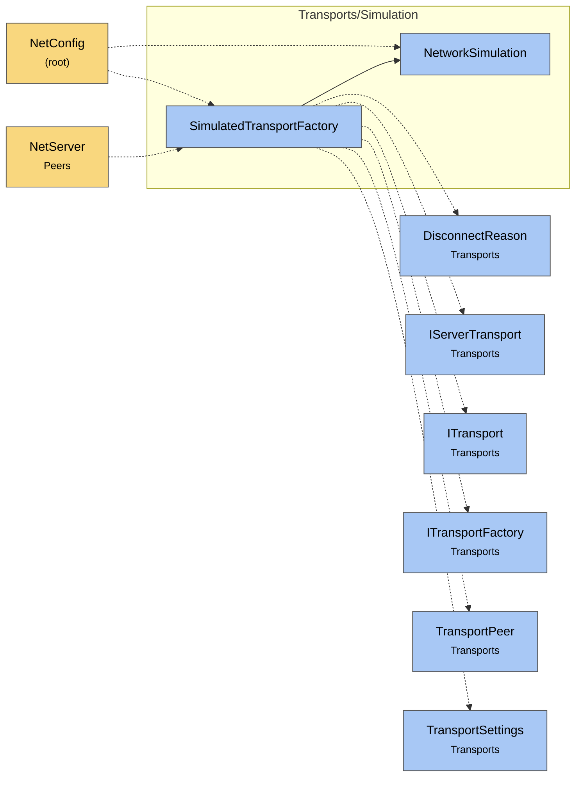

# Module map Transports Simulation

> [!info] Generated by `tools/generate-vault.py` from the source — do not edit by hand; rerun the script after code changes.

Modules in `src/NetSync/Transports/Simulation/`, their dependencies on each other, and the other folders they use or are used by.

Solid arrows stay inside the folder; dotted ones cross its boundary (outside modules are coloured by layer). Also uses the utilities [[NetTime]].

| Module | Summary | Uses | Used by |
|---|---|---|---|
| [[NetworkSimulation]] | A bad network, on demand — for development and testing only. Set `Simulation` on one peer (typically the client) to see how the application behaves with… | 0 | 2 |
| [[SimulatedTransportFactory]] | Wraps any transport factory with a `NetworkSimulation`. NetSync applies it automatically when `Simulation` is set; use it directly to simulate only one slot… | 8 | 2 |
