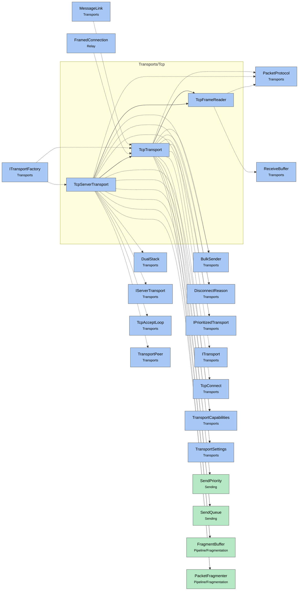

# Module map Transports Tcp

> [!info] Generated by `tools/generate-vault.py` from the source — do not edit by hand; rerun the script after code changes.

Modules in `src/NetSync/Transports/Tcp/`, their dependencies on each other, and the other folders they use or are used by.

Solid arrows stay inside the folder; dotted ones cross its boundary (outside modules are coloured by layer). Also uses the utilities [[INetLogger]], [[NetMetrics]], [[NetTime]], [[Pooled]].

| Module | Summary | Uses | Used by |
|---|---|---|---|
| [[TcpFrameReader]] | Incremental TCP frame parser over a `ReceiveBuffer`. A single socket read usually brings in many small frames; they are parsed and delivered straight from… | 2 | 2 |
| [[TcpServerTransport]] | Server-side TCP transport: accepts clients, frames packets, pings peers and drops the ones that stop answering. Every peer gets its own priority… | 19 | 1 |
| [[TcpTransport]] | Client-side TCP transport. Frames packets, keeps the link alive with ping/pong, fragments large payloads so bulk data never blocks small real-time packets.… | 17 | 4 |
