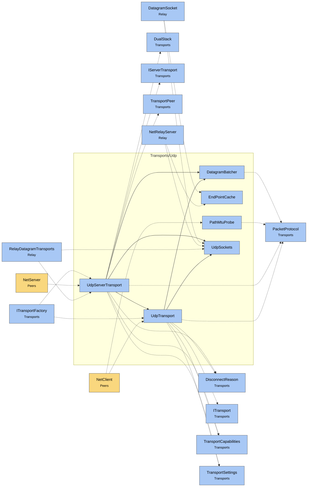

# Module map Transports Udp

> [!info] Generated by `tools/generate-vault.py` from the source — do not edit by hand; rerun the script after code changes.

Modules in `src/NetSync/Transports/Udp/`, their dependencies on each other, and the other folders they use or are used by.

Solid arrows stay inside the folder; dotted ones cross its boundary (outside modules are coloured by layer). Also uses the utilities [[AsyncSignal]], [[INetLogger]], [[NetMetrics]], [[NetTime]], [[Pooled]].

| Module | Summary | Uses | Used by |
|---|---|---|---|
| [[DatagramBatcher]] | Packs small UDP packets into shared datagrams — one socket call carries many messages. Callers only copy their packet into the destination's open batch; one… | 4 | 2 |
| [[EndPointCache]] | Allocation-free source addresses for unconnected UDP receives (net8.0): receive into `Address`, then `Resolve` returns the same `IPEndPoint` instance for a… | 0 | 2 |
| [[PathMtuProbe]] | Measures how large a UDP datagram can travel to the server unfragmented: sends "don't fragment" probes of decreasing size from a side socket and takes the… | 1 | 1 |
| [[UdpServerTransport]] | Server-side UDP transport. Tracks peers by source address, pings them actively and expires the silent ones. One socket, one receive thread, one reused… | 13 | 3 |
| [[UdpSockets]] | Socket setup shared by the UDP transports. | 0 | 5 |
| [[UdpTransport]] | Client-side UDP transport. Connectionless at the socket level; liveness is tracked via ping/pong. The reliability layer adds retransmission, ordering and… | 11 | 3 |
