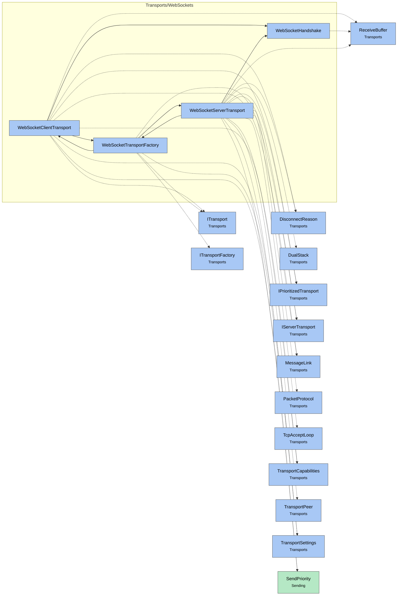

# Module map Transports WebSockets

> [!info] Generated by `tools/generate-vault.py` from the source — do not edit by hand; rerun the script after code changes.

Modules in `src/NetSync/Transports/WebSockets/`, their dependencies on each other, and the other folders they use or are used by.

Solid arrows stay inside the folder; dotted ones cross its boundary (outside modules are coloured by layer). Also uses the utilities [[INetLogger]], [[NetMetrics]], [[NetTime]].

| Module | Summary | Uses | Used by |
|---|---|---|---|
| [[WebSocketClientTransport]] | Client side of `WebSocketTransportFactory`: NetSync packets as WebSocket messages (`MessageLink`), with ping/pong keepalive and a write watchdog. | 12 | 1 |
| [[WebSocketHandshake]] | Server side of the RFC 6455 opening handshake, on a raw (or TLS) stream. Deliberately strict and small: bounded request size, GET on the configured path,… | 1 | 2 |
| [[WebSocketServerTransport]] | Server side of `WebSocketTransportFactory`: a TCP listener that performs the HTTP upgrade itself (optionally inside TLS), then speaks the same packets as… | 16 | 1 |
| [[WebSocketTransportFactory]] | WebSocket transport for the `Tcp` slot — the way browsers (WebAssembly, Blazor) and networks that only let HTTP(S) through reach a NetSync server. The whole… | 6 | 2 |
