# Module map Transports

> [!info] Generated by `tools/generate-vault.py` from the source — do not edit by hand; rerun the script after code changes.

Modules in `src/NetSync/Transports/`, their dependencies on each other, and the other folders they use or are used by.

```mermaid
flowchart LR
  subgraph f_Transports["Transports"]
    m_BulkSender["BulkSender"]:::transports
    m_DisconnectReason["DisconnectReason"]:::transports
    m_DualStack["DualStack"]:::transports
    m_IPrioritizedTransport["IPrioritizedTransport"]:::transports
    m_IServerTransport["IServerTransport"]:::transports
    m_ITransport["ITransport"]:::transports
    m_ITransportFactory["ITransportFactory"]:::transports
    m_MessageLink["MessageLink"]:::transports
    m_PacketProtocol["PacketProtocol"]:::transports
    m_ReceiveBuffer["ReceiveBuffer"]:::transports
    m_TcpAcceptLoop["TcpAcceptLoop"]:::transports
    m_TcpConnect["TcpConnect"]:::transports
    m_TransportCapabilities["TransportCapabilities"]:::transports
    m_TransportPeer["TransportPeer"]:::transports
    m_TransportSettings["TransportSettings"]:::transports
  end
  m_NetConfig["NetConfig<br/><small>(root)</small>"]:::api
  m_NetClient["NetClient<br/><small>Peers</small>"]:::api
  m_NetConnection["NetConnection<br/><small>Peers</small>"]:::api
  m_NetListener["NetListener<br/><small>Peers</small>"]:::api
  m_NetServer["NetServer<br/><small>Peers</small>"]:::api
  m_NetQuery["NetQuery<br/><small>Discovery</small>"]:::api
  m_ReliabilityMode["ReliabilityMode<br/><small>Pipeline/Reliability</small>"]:::session
  m_ReliableEndpoint["ReliableEndpoint<br/><small>Pipeline/Reliability</small>"]:::session
  m_TcpFrameReader["TcpFrameReader<br/><small>Transports/Tcp</small>"]:::transports
  m_TcpServerTransport["TcpServerTransport<br/><small>Transports/Tcp</small>"]:::transports
  m_TcpTransport["TcpTransport<br/><small>Transports/Tcp</small>"]:::transports
  m_DatagramBatcher["DatagramBatcher<br/><small>Transports/Udp</small>"]:::transports
  m_PathMtuProbe["PathMtuProbe<br/><small>Transports/Udp</small>"]:::transports
  m_UdpServerTransport["UdpServerTransport<br/><small>Transports/Udp</small>"]:::transports
  m_UdpTransport["UdpTransport<br/><small>Transports/Udp</small>"]:::transports
  m_WebSocketClientTransport["WebSocketClientTransport<br/><small>Transports/WebSockets</small>"]:::transports
  m_WebSocketHandshake["WebSocketHandshake<br/><small>Transports/WebSockets</small>"]:::transports
  m_WebSocketServerTransport["WebSocketServerTransport<br/><small>Transports/WebSockets</small>"]:::transports
  m_WebSocketTransportFactory["WebSocketTransportFactory<br/><small>Transports/WebSockets</small>"]:::transports
  m_SimulatedTransportFactory["SimulatedTransportFactory<br/><small>Transports/Simulation</small>"]:::transports
  m_FramedConnection["FramedConnection<br/><small>Relay</small>"]:::transports
  m_NetRelayServer["NetRelayServer<br/><small>Relay</small>"]:::transports
  m_RelayDatagramTransports["RelayDatagramTransports<br/><small>Relay</small>"]:::transports
  m_RelayHostSession["RelayHostSession<br/><small>Relay</small>"]:::transports
  m_RelayProtocol["RelayProtocol<br/><small>Relay</small>"]:::transports
  m_RelayRoom["RelayRoom<br/><small>Relay</small>"]:::transports
  m_RelayStreamTransports["RelayStreamTransports<br/><small>Relay</small>"]:::transports
  m_SendPriority["SendPriority<br/><small>Sending</small>"]:::infrastructure
  m_SendQueue["SendQueue<br/><small>Sending</small>"]:::infrastructure
  m_FragmentBuffer["FragmentBuffer<br/><small>Pipeline/Fragmentation</small>"]:::infrastructure
  m_PacketFragmenter["PacketFragmenter<br/><small>Pipeline/Fragmentation</small>"]:::infrastructure
  m_BulkSender -.-> m_PacketFragmenter
  m_BulkSender --> m_PacketProtocol
  m_BulkSender -.-> m_SendPriority
  m_BulkSender -.-> m_SendQueue
  m_TcpServerTransport -.-> m_BulkSender
  m_TcpTransport -.-> m_BulkSender
  m_NetClient -.-> m_DisconnectReason
  m_NetServer -.-> m_DisconnectReason
  m_RelayDatagramTransports -.-> m_DisconnectReason
  m_RelayStreamTransports -.-> m_DisconnectReason
  m_ReliableEndpoint -.-> m_DisconnectReason
  m_SimulatedTransportFactory -.-> m_DisconnectReason
  m_TcpServerTransport -.-> m_DisconnectReason
  m_TcpTransport -.-> m_DisconnectReason
  m_UdpServerTransport -.-> m_DisconnectReason
  m_UdpTransport -.-> m_DisconnectReason
  m_WebSocketClientTransport -.-> m_DisconnectReason
  m_WebSocketServerTransport -.-> m_DisconnectReason
  m_NetRelayServer -.-> m_DualStack
  m_RelayDatagramTransports -.-> m_DualStack
  m_TcpServerTransport -.-> m_DualStack
  m_UdpServerTransport -.-> m_DualStack
  m_WebSocketServerTransport -.-> m_DualStack
  m_IPrioritizedTransport -.-> m_ReliabilityMode
  m_IPrioritizedTransport -.-> m_SendPriority
  m_IPrioritizedTransport --> m_TransportPeer
  m_NetClient -.-> m_IPrioritizedTransport
  m_NetServer -.-> m_IPrioritizedTransport
  m_RelayStreamTransports -.-> m_IPrioritizedTransport
  m_TcpServerTransport -.-> m_IPrioritizedTransport
  m_TcpTransport -.-> m_IPrioritizedTransport
  m_WebSocketClientTransport -.-> m_IPrioritizedTransport
  m_WebSocketServerTransport -.-> m_IPrioritizedTransport
  m_IServerTransport --> m_DisconnectReason
  m_IServerTransport --> m_TransportPeer
  m_NetServer -.-> m_IServerTransport
  m_RelayDatagramTransports -.-> m_IServerTransport
  m_RelayRoom -.-> m_IServerTransport
  m_RelayStreamTransports -.-> m_IServerTransport
  m_SimulatedTransportFactory -.-> m_IServerTransport
  m_TcpServerTransport -.-> m_IServerTransport
  m_UdpServerTransport -.-> m_IServerTransport
  m_WebSocketServerTransport -.-> m_IServerTransport
  m_WebSocketTransportFactory -.-> m_IServerTransport
  m_ITransport --> m_DisconnectReason
  m_NetClient -.-> m_ITransport
  m_RelayDatagramTransports -.-> m_ITransport
  m_RelayRoom -.-> m_ITransport
  m_RelayStreamTransports -.-> m_ITransport
  m_SimulatedTransportFactory -.-> m_ITransport
  m_TcpTransport -.-> m_ITransport
  m_UdpTransport -.-> m_ITransport
  m_WebSocketClientTransport -.-> m_ITransport
  m_WebSocketTransportFactory -.-> m_ITransport
  m_ITransportFactory --> m_IServerTransport
  m_ITransportFactory --> m_ITransport
  m_ITransportFactory -.-> m_TcpServerTransport
  m_ITransportFactory -.-> m_TcpTransport
  m_ITransportFactory --> m_TransportSettings
  m_ITransportFactory -.-> m_UdpServerTransport
  m_ITransportFactory -.-> m_UdpTransport
  m_NetConfig -.-> m_ITransportFactory
  m_NetListener -.-> m_ITransportFactory
  m_NetServer -.-> m_ITransportFactory
  m_RelayRoom -.-> m_ITransportFactory
  m_SimulatedTransportFactory -.-> m_ITransportFactory
  m_WebSocketTransportFactory -.-> m_ITransportFactory
  m_MessageLink --> m_BulkSender
  m_MessageLink -.-> m_FragmentBuffer
  m_MessageLink --> m_IPrioritizedTransport
  m_MessageLink -.-> m_PacketFragmenter
  m_MessageLink --> m_PacketProtocol
  m_MessageLink -.-> m_SendPriority
  m_MessageLink -.-> m_SendQueue
  m_MessageLink -.-> m_TcpTransport
  m_MessageLink --> m_TransportSettings
  m_RelayProtocol -.-> m_MessageLink
  m_RelayStreamTransports -.-> m_MessageLink
  m_WebSocketClientTransport -.-> m_MessageLink
  m_WebSocketServerTransport -.-> m_MessageLink
  m_PacketProtocol -.-> m_PacketFragmenter
  m_DatagramBatcher -.-> m_PacketProtocol
  m_NetQuery -.-> m_PacketProtocol
  m_PacketFragmenter -.-> m_PacketProtocol
  m_PathMtuProbe -.-> m_PacketProtocol
  m_RelayDatagramTransports -.-> m_PacketProtocol
  m_RelayStreamTransports -.-> m_PacketProtocol
  m_TcpFrameReader -.-> m_PacketProtocol
  m_TcpServerTransport -.-> m_PacketProtocol
  m_TcpTransport -.-> m_PacketProtocol
  m_UdpServerTransport -.-> m_PacketProtocol
  m_UdpTransport -.-> m_PacketProtocol
  m_WebSocketServerTransport -.-> m_PacketProtocol
  m_FramedConnection -.-> m_ReceiveBuffer
  m_TcpFrameReader -.-> m_ReceiveBuffer
  m_WebSocketClientTransport -.-> m_ReceiveBuffer
  m_WebSocketHandshake -.-> m_ReceiveBuffer
  m_WebSocketServerTransport -.-> m_ReceiveBuffer
  m_NetRelayServer -.-> m_TcpAcceptLoop
  m_TcpServerTransport -.-> m_TcpAcceptLoop
  m_WebSocketServerTransport -.-> m_TcpAcceptLoop
  m_RelayHostSession -.-> m_TcpConnect
  m_RelayStreamTransports -.-> m_TcpConnect
  m_TcpTransport -.-> m_TcpConnect
  m_TransportCapabilities --> m_TransportPeer
  m_NetClient -.-> m_TransportCapabilities
  m_NetServer -.-> m_TransportCapabilities
  m_RelayDatagramTransports -.-> m_TransportCapabilities
  m_RelayStreamTransports -.-> m_TransportCapabilities
  m_TcpServerTransport -.-> m_TransportCapabilities
  m_TcpTransport -.-> m_TransportCapabilities
  m_UdpServerTransport -.-> m_TransportCapabilities
  m_UdpTransport -.-> m_TransportCapabilities
  m_WebSocketClientTransport -.-> m_TransportCapabilities
  m_WebSocketServerTransport -.-> m_TransportCapabilities
  m_TransportPeer --> m_IServerTransport
  m_NetConnection -.-> m_TransportPeer
  m_NetServer -.-> m_TransportPeer
  m_RelayDatagramTransports -.-> m_TransportPeer
  m_RelayStreamTransports -.-> m_TransportPeer
  m_SimulatedTransportFactory -.-> m_TransportPeer
  m_TcpServerTransport -.-> m_TransportPeer
  m_UdpServerTransport -.-> m_TransportPeer
  m_WebSocketServerTransport -.-> m_TransportPeer
  m_TransportSettings -.-> m_NetConfig
  m_NetClient -.-> m_TransportSettings
  m_NetConfig -.-> m_TransportSettings
  m_NetServer -.-> m_TransportSettings
  m_RelayDatagramTransports -.-> m_TransportSettings
  m_RelayRoom -.-> m_TransportSettings
  m_RelayStreamTransports -.-> m_TransportSettings
  m_SimulatedTransportFactory -.-> m_TransportSettings
  m_TcpServerTransport -.-> m_TransportSettings
  m_TcpTransport -.-> m_TransportSettings
  m_UdpServerTransport -.-> m_TransportSettings
  m_UdpTransport -.-> m_TransportSettings
  m_WebSocketClientTransport -.-> m_TransportSettings
  m_WebSocketServerTransport -.-> m_TransportSettings
  m_WebSocketTransportFactory -.-> m_TransportSettings
  classDef api fill:#f9d77e,stroke:#555,color:#000
  classDef session fill:#e3b8f0,stroke:#555,color:#000
  classDef transports fill:#a8c8f5,stroke:#555,color:#000
  classDef infrastructure fill:#b5e8c5,stroke:#555,color:#000
  classDef foundation fill:#dddddd,stroke:#555,color:#000
```

Solid arrows stay inside the folder; dotted ones cross its boundary (outside modules are coloured by layer). Also uses the utilities [[INetLogger]], [[NetMetrics]], [[NetTime]], [[Pooled]].

| Module | Summary | Uses | Used by |
|---|---|---|---|
| [[BulkSender]] | Sends a large message as fragment frames through a send queue, with backpressure — for stream links (TCP frames: [type][length][body]) and message links… | 6 | 3 |
| [[DisconnectReason]] | Why a connection ended. Replaces the old OnDisconnected/OnServerDisconnected event pair: subscribers get a single event with an explicit reason. | 0 | 14 |
| [[DualStack]] | Server sockets that accept IPv4 and IPv6 clients on one port (dual-stack), with an automatic IPv4-only fallback where the OS or runtime lacks IPv6. Apple's… | 0 | 5 |
| [[IPrioritizedTransport]] | Optional capability: a client transport with an internal send queue can honor per-channel priority (`ChannelPriority`). The peer layer uses it when present… | 3 | 8 |
| [[IServerTransport]] | Server-side transport: listens on a port and manages many peers. Events are raised on background network threads (see `ITransport` notes). | 2 | 11 |
| [[ITransport]] | Client-side transport: a single link to a remote server. Threading contract: all events are raised on background network threads. Never block inside a… | 1 | 10 |
| [[ITransportFactory]] | Creates the implementation behind a transport slot. Register a factory in `TransportFactories` to run NetSync over your own transport (WebSocket, a platform… | 7 | 6 |
| [[MessageLink]] | NetSync packets over any reliable, message-preserving pipe (a WebSocket, a relay tunnel): [type:1][payload] per message — Ping, Pong, Data — with a priority… | 12 | 4 |
| [[PacketProtocol]] | Wire format helpers. UDP datagram: [type:1][payload] TCP frame: [type:1][length:4 BE][payload] (Ping/Pong: [type:1][timestamp:8 BE]) Frame builders write… | 1 | 14 |
| [[ReceiveBuffer]] | A connection's receive buffer that is small while traffic is small. It starts at `SmallSize` — enough for many small frames per socket read — grows only… | 1 | 5 |
| [[TcpAcceptLoop]] | The accept loop of every TCP-based listener (TCP, WebSocket, relay). One misbehaving client never stops the listener: each is served on its own task, and a… | 1 | 3 |
| [[TcpConnect]] | Outgoing TCP connects that honor cancellation on every target. | 0 | 3 |
| [[TransportCapabilities]] | Zero-copy delivery for a client transport: the peer layer receives the transport's own (pooled) buffer, valid only during the call. When set, DataReceived… | 2 | 10 |
| [[TransportPeer]] | A remote peer as seen by a server transport. Transport-specific state stays inside the transport (`TransportState` is internal on purpose). | 2 | 11 |
| [[TransportSettings]] | Tuning shared by all built-in transports. `NetClient` and `NetServer` fill it from `NetConfig`. | 2 | 16 |
