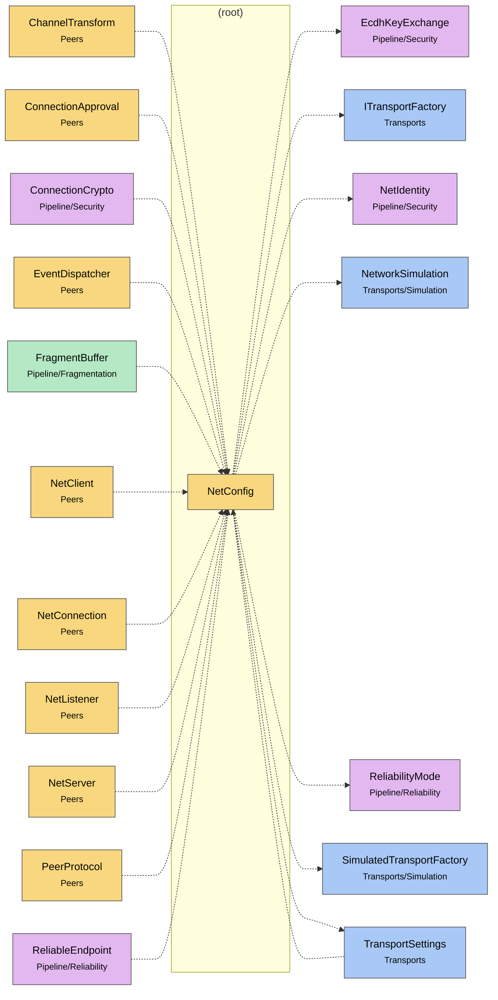

# Module map root

> [!info] Generated by `tools/generate-vault.py` from the source — do not edit by hand; rerun the script after code changes.

Modules in `src/NetSync/`, their dependencies on each other, and the other folders they use or are used by.

Solid arrows stay inside the folder; dotted ones cross its boundary (outside modules are coloured by layer). Also uses the utilities [[INetLogger]].

| Module | Summary | Uses | Used by |
|---|---|---|---|
| [[NetConfig]] | Shared configuration for `NetClient` and `NetServer`. Client and server must agree on the channel table (same ids, same transports). When `Channels` is left… | 8 | 12 |
