# Type hierarchy

> [!info] Generated by `tools/generate-vault.py` from the source — do not edit by hand; rerun the script after code changes.

Inheritance and interface implementation among the core's own types (`..|>` implements, `--|>` extends). Transports are interchangeable through these contracts — see [[Custom transports]].

```mermaid
classDiagram
  direction LR
  ConsoleNetLogger ..|> INetLogger
  DatagramSocket ..|> IDatagramSocket
  NullNetLogger ..|> INetLogger
  RelayDatagramClientTransport ..|> ITransport
  RelayDatagramClientTransport ..|> IPooledReceiveTransport
  RelayDatagramHostTransport ..|> IServerTransport
  RelayDatagramHostTransport ..|> IPooledReceiveServerTransport
  RelayDatagramHostTransport ..|> ITrustAwareServerTransport
  RelayStreamClientTransport ..|> ITransport
  RelayStreamClientTransport ..|> IPrioritizedTransport
  RelayStreamClientTransport ..|> IPooledReceiveTransport
  RelayStreamHostTransport ..|> IServerTransport
  RelayStreamHostTransport ..|> IPrioritizedServerTransport
  SimulatedClientTransport ..|> ITransport
  SimulatedServerTransport ..|> IServerTransport
  SimulatedServerTransport ..|> IWrappedServerTransport
  SimulatedTransportFactory ..|> ITransportFactory
  TcpServerTransport ..|> IServerTransport
  TcpServerTransport ..|> IPrioritizedServerTransport
  TcpServerTransport ..|> IPooledReceiveServerTransport
  TcpServerTransport ..|> ITrustAwareServerTransport
  TcpTransport ..|> ITransport
  TcpTransport ..|> IPrioritizedTransport
  TcpTransport ..|> IPooledReceiveTransport
  TcpTransportFactory ..|> ITransportFactory
  UdpServerTransport ..|> IServerTransport
  UdpServerTransport ..|> IPooledReceiveServerTransport
  UdpServerTransport ..|> IDatagramBoundaryServerTransport
  UdpTransport ..|> ITransport
  UdpTransport ..|> IPooledReceiveTransport
  UdpTransport ..|> IDatagramBoundaryTransport
  UdpTransportFactory ..|> ITransportFactory
  WebSocketClientTransport ..|> ITransport
  WebSocketClientTransport ..|> IPrioritizedTransport
  WebSocketClientTransport ..|> IPooledReceiveTransport
  WebSocketServerTransport ..|> IServerTransport
  WebSocketServerTransport ..|> IPrioritizedServerTransport
  WebSocketTransportFactory ..|> ITransportFactory
  class IDatagramBoundaryServerTransport
  <<interface>> IDatagramBoundaryServerTransport
  class IDatagramBoundaryTransport
  <<interface>> IDatagramBoundaryTransport
  class IDatagramSocket
  <<interface>> IDatagramSocket
  class INetLogger
  <<interface>> INetLogger
  class IPooledReceiveServerTransport
  <<interface>> IPooledReceiveServerTransport
  class IPooledReceiveTransport
  <<interface>> IPooledReceiveTransport
  class IPrioritizedServerTransport
  <<interface>> IPrioritizedServerTransport
  class IPrioritizedTransport
  <<interface>> IPrioritizedTransport
  class IServerTransport
  <<interface>> IServerTransport
  class ITransport
  <<interface>> ITransport
  class ITransportFactory
  <<interface>> ITransportFactory
  class ITrustAwareServerTransport
  <<interface>> ITrustAwareServerTransport
  class IWrappedServerTransport
  <<interface>> IWrappedServerTransport
```

## Who implements what

| Contract | Implementations |
|---|---|
| [[TransportCapabilities\|IDatagramBoundaryServerTransport]] | [[UdpServerTransport\|UdpServerTransport]] |
| [[TransportCapabilities\|IDatagramBoundaryTransport]] | [[UdpTransport\|UdpTransport]] |
| [[DatagramSocket\|IDatagramSocket]] | [[DatagramSocket\|DatagramSocket]] |
| [[INetLogger\|INetLogger]] | [[INetLogger\|ConsoleNetLogger]], [[INetLogger\|NullNetLogger]] |
| [[TransportCapabilities\|IPooledReceiveServerTransport]] | [[RelayDatagramTransports\|RelayDatagramHostTransport]], [[TcpServerTransport\|TcpServerTransport]], [[UdpServerTransport\|UdpServerTransport]] |
| [[TransportCapabilities\|IPooledReceiveTransport]] | [[RelayDatagramTransports\|RelayDatagramClientTransport]], [[RelayStreamTransports\|RelayStreamClientTransport]], [[TcpTransport\|TcpTransport]], [[UdpTransport\|UdpTransport]], [[WebSocketClientTransport\|WebSocketClientTransport]] |
| [[IPrioritizedTransport\|IPrioritizedServerTransport]] | [[RelayStreamTransports\|RelayStreamHostTransport]], [[TcpServerTransport\|TcpServerTransport]], [[WebSocketServerTransport\|WebSocketServerTransport]] |
| [[IPrioritizedTransport\|IPrioritizedTransport]] | [[RelayStreamTransports\|RelayStreamClientTransport]], [[TcpTransport\|TcpTransport]], [[WebSocketClientTransport\|WebSocketClientTransport]] |
| [[IServerTransport\|IServerTransport]] | [[RelayDatagramTransports\|RelayDatagramHostTransport]], [[RelayStreamTransports\|RelayStreamHostTransport]], [[SimulatedTransportFactory\|SimulatedServerTransport]], [[TcpServerTransport\|TcpServerTransport]], [[UdpServerTransport\|UdpServerTransport]], [[WebSocketServerTransport\|WebSocketServerTransport]] |
| [[ITransport\|ITransport]] | [[RelayDatagramTransports\|RelayDatagramClientTransport]], [[RelayStreamTransports\|RelayStreamClientTransport]], [[SimulatedTransportFactory\|SimulatedClientTransport]], [[TcpTransport\|TcpTransport]], [[UdpTransport\|UdpTransport]], [[WebSocketClientTransport\|WebSocketClientTransport]] |
| [[ITransportFactory\|ITransportFactory]] | [[SimulatedTransportFactory\|SimulatedTransportFactory]], [[ITransportFactory\|TcpTransportFactory]], [[ITransportFactory\|UdpTransportFactory]], [[WebSocketTransportFactory\|WebSocketTransportFactory]] |
| [[TransportCapabilities\|ITrustAwareServerTransport]] | [[RelayDatagramTransports\|RelayDatagramHostTransport]], [[TcpServerTransport\|TcpServerTransport]] |
| [[SimulatedTransportFactory\|IWrappedServerTransport]] | [[SimulatedTransportFactory\|SimulatedServerTransport]] |
