# Type hierarchy

> [!NOTE]
> Generated by `tools/generate-vault.py` from the source — do not edit by hand; rerun the script after code changes.

Inheritance and interface implementation among the core's own types (`..|>` implements, `--|>` extends). Transports are interchangeable through these contracts — see [Custom transports](../2%20Guides/Custom%20transports.md).

```mermaid
classDiagram
  direction LR
  ConsoleNetLogger ..|> INetLogger
  DatagramSocket ..|> IDatagramSocket
  NullNetLogger ..|> INetLogger
  RelayDatagramClientTransport ..|> ITransport
  RelayDatagramClientTransport ..|> IPooledReceiveTransport
  RelayDatagramHostTransport ..|> IServerTransport
  RelayDatagramHostTransport ..|> IPooledReceiveServerTransport
  RelayDatagramHostTransport ..|> ITrustAwareServerTransport
  RelayStreamClientTransport ..|> ITransport
  RelayStreamClientTransport ..|> IPrioritizedTransport
  RelayStreamClientTransport ..|> IPooledReceiveTransport
  RelayStreamHostTransport ..|> IServerTransport
  RelayStreamHostTransport ..|> IPeerFlushingServerTransport
  RelayStreamHostTransport ..|> IPrioritizedServerTransport
  SimulatedClientTransport ..|> ITransport
  SimulatedServerTransport ..|> IServerTransport
  SimulatedServerTransport ..|> IWrappedServerTransport
  SimulatedTransportFactory ..|> ITransportFactory
  TcpServerTransport ..|> IServerTransport
  TcpServerTransport ..|> IPeerFlushingServerTransport
  TcpServerTransport ..|> IPrioritizedServerTransport
  TcpServerTransport ..|> IPooledReceiveServerTransport
  TcpServerTransport ..|> ITrustAwareServerTransport
  TcpTransport ..|> ITransport
  TcpTransport ..|> IPrioritizedTransport
  TcpTransport ..|> IPooledReceiveTransport
  TcpTransportFactory ..|> ITransportFactory
  UdpServerTransport ..|> IServerTransport
  UdpServerTransport ..|> IPooledReceiveServerTransport
  UdpServerTransport ..|> IDatagramBoundaryServerTransport
  UdpTransport ..|> ITransport
  UdpTransport ..|> IPooledReceiveTransport
  UdpTransport ..|> IDatagramBoundaryTransport
  UdpTransportFactory ..|> ITransportFactory
  WebSocketClientTransport ..|> ITransport
  WebSocketClientTransport ..|> IPrioritizedTransport
  WebSocketClientTransport ..|> IPooledReceiveTransport
  WebSocketServerTransport ..|> IPeerFlushingServerTransport
  WebSocketServerTransport ..|> IServerTransport
  WebSocketServerTransport ..|> IPrioritizedServerTransport
  WebSocketTransportFactory ..|> ITransportFactory
  class IDatagramBoundaryServerTransport
  <<interface>> IDatagramBoundaryServerTransport
  class IDatagramBoundaryTransport
  <<interface>> IDatagramBoundaryTransport
  class IDatagramSocket
  <<interface>> IDatagramSocket
  class INetLogger
  <<interface>> INetLogger
  class IPeerFlushingServerTransport
  <<interface>> IPeerFlushingServerTransport
  class IPooledReceiveServerTransport
  <<interface>> IPooledReceiveServerTransport
  class IPooledReceiveTransport
  <<interface>> IPooledReceiveTransport
  class IPrioritizedServerTransport
  <<interface>> IPrioritizedServerTransport
  class IPrioritizedTransport
  <<interface>> IPrioritizedTransport
  class IServerTransport
  <<interface>> IServerTransport
  class ITransport
  <<interface>> ITransport
  class ITransportFactory
  <<interface>> ITransportFactory
  class ITrustAwareServerTransport
  <<interface>> ITrustAwareServerTransport
  class IWrappedServerTransport
  <<interface>> IWrappedServerTransport
```

## Who implements what

| Contract | Implementations |
|---|---|
| [IDatagramBoundaryServerTransport](../Code/Transports/TransportCapabilities.md) | [UdpServerTransport](../Code/Transports/Udp/UdpServerTransport.md) |
| [IDatagramBoundaryTransport](../Code/Transports/TransportCapabilities.md) | [UdpTransport](../Code/Transports/Udp/UdpTransport.md) |
| [IDatagramSocket](../Code/Relay/DatagramSocket.md) | [DatagramSocket](../Code/Relay/DatagramSocket.md) |
| [INetLogger](../Code/Diagnostics/INetLogger.md) | [ConsoleNetLogger](../Code/Diagnostics/INetLogger.md), [NullNetLogger](../Code/Diagnostics/INetLogger.md) |
| [IPeerFlushingServerTransport](../Code/Transports/TransportCapabilities.md) | [RelayStreamHostTransport](../Code/Relay/RelayStreamTransports.md), [TcpServerTransport](../Code/Transports/Tcp/TcpServerTransport.md), [WebSocketServerTransport](../Code/Transports/WebSockets/WebSocketServerTransport.md) |
| [IPooledReceiveServerTransport](../Code/Transports/TransportCapabilities.md) | [RelayDatagramHostTransport](../Code/Relay/RelayDatagramTransports.md), [TcpServerTransport](../Code/Transports/Tcp/TcpServerTransport.md), [UdpServerTransport](../Code/Transports/Udp/UdpServerTransport.md) |
| [IPooledReceiveTransport](../Code/Transports/TransportCapabilities.md) | [RelayDatagramClientTransport](../Code/Relay/RelayDatagramTransports.md), [RelayStreamClientTransport](../Code/Relay/RelayStreamTransports.md), [TcpTransport](../Code/Transports/Tcp/TcpTransport.md), [UdpTransport](../Code/Transports/Udp/UdpTransport.md), [WebSocketClientTransport](../Code/Transports/WebSockets/WebSocketClientTransport.md) |
| [IPrioritizedServerTransport](../Code/Transports/IPrioritizedTransport.md) | [RelayStreamHostTransport](../Code/Relay/RelayStreamTransports.md), [TcpServerTransport](../Code/Transports/Tcp/TcpServerTransport.md), [WebSocketServerTransport](../Code/Transports/WebSockets/WebSocketServerTransport.md) |
| [IPrioritizedTransport](../Code/Transports/IPrioritizedTransport.md) | [RelayStreamClientTransport](../Code/Relay/RelayStreamTransports.md), [TcpTransport](../Code/Transports/Tcp/TcpTransport.md), [WebSocketClientTransport](../Code/Transports/WebSockets/WebSocketClientTransport.md) |
| [IServerTransport](../Code/Transports/IServerTransport.md) | [RelayDatagramHostTransport](../Code/Relay/RelayDatagramTransports.md), [RelayStreamHostTransport](../Code/Relay/RelayStreamTransports.md), [SimulatedServerTransport](../Code/Transports/Simulation/SimulatedTransportFactory.md), [TcpServerTransport](../Code/Transports/Tcp/TcpServerTransport.md), [UdpServerTransport](../Code/Transports/Udp/UdpServerTransport.md), [WebSocketServerTransport](../Code/Transports/WebSockets/WebSocketServerTransport.md) |
| [ITransport](../Code/Transports/ITransport.md) | [RelayDatagramClientTransport](../Code/Relay/RelayDatagramTransports.md), [RelayStreamClientTransport](../Code/Relay/RelayStreamTransports.md), [SimulatedClientTransport](../Code/Transports/Simulation/SimulatedTransportFactory.md), [TcpTransport](../Code/Transports/Tcp/TcpTransport.md), [UdpTransport](../Code/Transports/Udp/UdpTransport.md), [WebSocketClientTransport](../Code/Transports/WebSockets/WebSocketClientTransport.md) |
| [ITransportFactory](../Code/Transports/ITransportFactory.md) | [SimulatedTransportFactory](../Code/Transports/Simulation/SimulatedTransportFactory.md), [TcpTransportFactory](../Code/Transports/ITransportFactory.md), [UdpTransportFactory](../Code/Transports/ITransportFactory.md), [WebSocketTransportFactory](../Code/Transports/WebSockets/WebSocketTransportFactory.md) |
| [ITrustAwareServerTransport](../Code/Transports/TransportCapabilities.md) | [RelayDatagramHostTransport](../Code/Relay/RelayDatagramTransports.md), [TcpServerTransport](../Code/Transports/Tcp/TcpServerTransport.md) |
| [IWrappedServerTransport](../Code/Transports/Simulation/SimulatedTransportFactory.md) | [SimulatedServerTransport](../Code/Transports/Simulation/SimulatedTransportFactory.md) |
