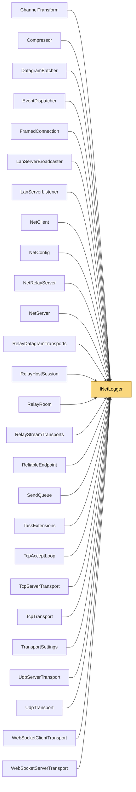

# INetLogger

> [!info] Generated by `tools/generate-vault.py` from the source — do not edit by hand; rerun the script after code changes.

Logging abstraction so the core stays platform-agnostic. Implementations must be thread-safe: transports log from background threads.

**Namespace** `NetSync.Diagnostics` · **Folder** [[Module map Diagnostics|Diagnostics]] · **Layer** Foundation

**Source** `src/NetSync/Diagnostics/INetLogger.cs`

## Types

| Type | Kind | Summary |
|---|---|---|
| `NetLogLevel` | public enum |  |
| `INetLogger` | public interface | Logging abstraction so the core stays platform-agnostic. Implementations must be thread-safe: transports log from background threads. |
| `NullNetLogger` | public sealed class | Discards everything. Default when no logger is supplied. |
| `ConsoleNetLogger` | public sealed class | Writes to `Console`. Handy for samples and server apps. |
| `NetLoggerExtensions` | internal static class |  |

## Extends / implements

- `NullNetLogger` → `INetLogger`
- `ConsoleNetLogger` → `INetLogger`

## Members

**NullNetLogger**

- `public static readonly NullNetLogger Instance = new NullNetLogger()`
- `public void Log(NetLogLevel level, string message)`

**ConsoleNetLogger**

- `public static readonly ConsoleNetLogger Instance = new ConsoleNetLogger()`
- `public NetLogLevel MinLevel`
- `public void Log(NetLogLevel level, string message)`

**NetLoggerExtensions**

- `public static void Debug(this INetLogger logger, string message)`
- `public static void Info(this INetLogger logger, string message)`
- `public static void Warning(this INetLogger logger, string message)`
- `public static void Error(this INetLogger logger, string message)`

## Depends on (0)

—

## Used by (26)

- **(root)**: [[NetConfig]] (`INetLogger`, `NullNetLogger`)
- **Peers**: [[ChannelTransform]], [[EventDispatcher]], [[NetClient]], [[NetServer]]
- **Discovery**: [[LanServerBroadcaster]] (`INetLogger`, `NullNetLogger`), [[LanServerListener]] (`INetLogger`, `NullNetLogger`)
- **Pipeline/Reliability**: [[ReliableEndpoint]]
- **Pipeline/Compression**: [[Compressor]]
- **Transports**: [[TcpAcceptLoop]], [[TransportSettings]] (`INetLogger`, `NullNetLogger`)
- **Transports/Tcp**: [[TcpServerTransport]], [[TcpTransport]]
- **Transports/Udp**: [[DatagramBatcher]], [[UdpServerTransport]], [[UdpTransport]]
- **Transports/WebSockets**: [[WebSocketClientTransport]], [[WebSocketServerTransport]]
- **Relay**: [[FramedConnection]], [[NetRelayServer]] (`INetLogger`, `NullNetLogger`), [[RelayDatagramTransports]], [[RelayHostSession]], [[RelayRoom]], [[RelayStreamTransports]]
- **Sending**: [[SendQueue]]
- **Internal**: [[TaskExtensions]]

## Neighbourhood

