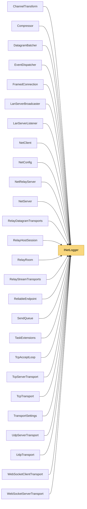

# INetLogger

> [!NOTE]
> Generated by `tools/generate-vault.py` from the source — do not edit by hand; rerun the script after code changes.

Logging abstraction so the core stays platform-agnostic. Implementations must be thread-safe: transports log from background threads.

**Namespace** `NetSync.Diagnostics` · **Folder** [Diagnostics](../../4%20Diagrams/Modules/Module%20map%20Diagnostics.md) · **Layer** Foundation

**Source** `src/NetSync/Diagnostics/INetLogger.cs`

## Types

| Type | Kind | Summary |
|---|---|---|
| `NetLogLevel` | public enum |  |
| `INetLogger` | public interface | Logging abstraction so the core stays platform-agnostic. Implementations must be thread-safe: transports log from background threads. |
| `NullNetLogger` | public sealed class | Discards everything. Default when no logger is supplied. |
| `ConsoleNetLogger` | public sealed class | Writes to `Console`. Handy for samples and server apps. |
| `NetLoggerExtensions` | internal static class |  |

## Extends / implements

- `NullNetLogger` → `INetLogger`
- `ConsoleNetLogger` → `INetLogger`

## Members

**NullNetLogger**

- `public static readonly NullNetLogger Instance = new NullNetLogger()`
- `public void Log(NetLogLevel level, string message)`

**ConsoleNetLogger**

- `public static readonly ConsoleNetLogger Instance = new ConsoleNetLogger()`
- `public NetLogLevel MinLevel`
- `public void Log(NetLogLevel level, string message)`

**NetLoggerExtensions**

- `public static void Debug(this INetLogger logger, string message)`
- `public static void Info(this INetLogger logger, string message)`
- `public static void Warning(this INetLogger logger, string message)`
- `public static void Error(this INetLogger logger, string message)`

## Depends on (0)

—

## Used by (26)

- **(root)**: [NetConfig](../Root/NetConfig.md) (`INetLogger`, `NullNetLogger`)
- **Peers**: [ChannelTransform](../Peers/ChannelTransform.md), [EventDispatcher](../Peers/EventDispatcher.md), [NetClient](../Peers/NetClient.md), [NetServer](../Peers/NetServer.md)
- **Discovery**: [LanServerBroadcaster](../Discovery/LanServerBroadcaster.md) (`INetLogger`, `NullNetLogger`), [LanServerListener](../Discovery/LanServerListener.md) (`INetLogger`, `NullNetLogger`)
- **Pipeline/Reliability**: [ReliableEndpoint](../Pipeline/Reliability/ReliableEndpoint.md)
- **Pipeline/Compression**: [Compressor](../Pipeline/Compression/Compressor.md)
- **Transports**: [TcpAcceptLoop](../Transports/TcpAcceptLoop.md), [TransportSettings](../Transports/TransportSettings.md) (`INetLogger`, `NullNetLogger`)
- **Transports/Tcp**: [TcpServerTransport](../Transports/Tcp/TcpServerTransport.md), [TcpTransport](../Transports/Tcp/TcpTransport.md)
- **Transports/Udp**: [DatagramBatcher](../Transports/Udp/DatagramBatcher.md), [UdpServerTransport](../Transports/Udp/UdpServerTransport.md), [UdpTransport](../Transports/Udp/UdpTransport.md)
- **Transports/WebSockets**: [WebSocketClientTransport](../Transports/WebSockets/WebSocketClientTransport.md), [WebSocketServerTransport](../Transports/WebSockets/WebSocketServerTransport.md)
- **Relay**: [FramedConnection](../Relay/FramedConnection.md), [NetRelayServer](../Relay/NetRelayServer.md) (`INetLogger`, `NullNetLogger`), [RelayDatagramTransports](../Relay/RelayDatagramTransports.md), [RelayHostSession](../Relay/RelayHostSession.md), [RelayRoom](../Relay/RelayRoom.md), [RelayStreamTransports](../Relay/RelayStreamTransports.md)
- **Sending**: [SendQueue](../Sending/SendQueue.md)
- **Internal**: [TaskExtensions](../Internal/TaskExtensions.md)

## Neighbourhood

